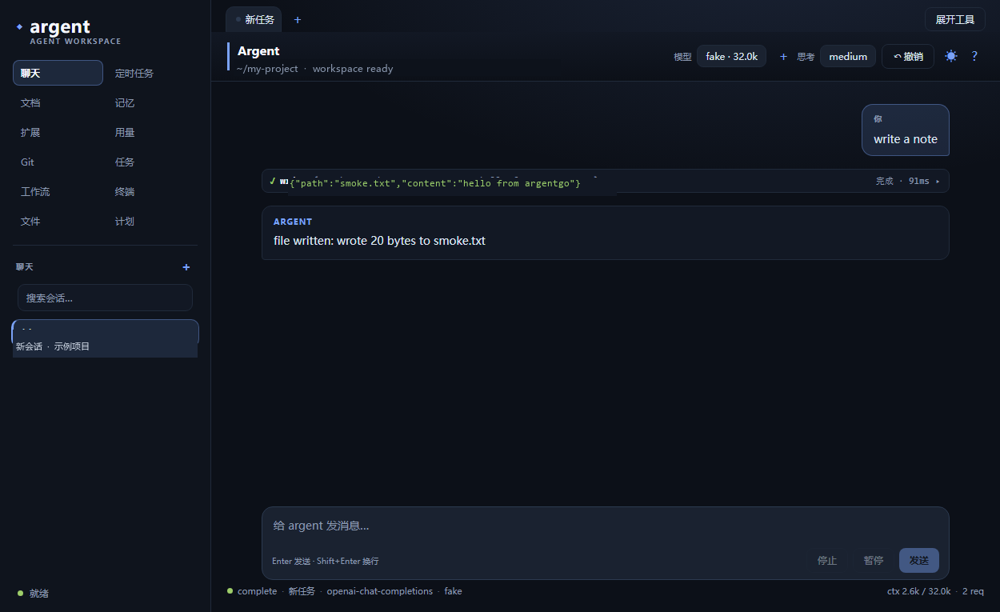

<div align="center">

# argentgo

**一个把想法直接变成代码的小型 Agent 运行时。**

单文件、零依赖、离线优先。流式对话、真实工具调用、可回放的会话树——
一个二进制，从命令行到桌面窗口都能用。

[下载 Windows 版](https://github.com/2118505078xyh1/argentgo/releases/latest) ·
[快速开始](#快速开始) ·
[特性](#为什么选-argentgo) ·
[文档](#文档)



</div>

---

## 为什么选 argentgo

- **单文件，零负担** — 纯 Go 标准库，**无第三方依赖、无 cgo**。下载一个 `.exe` 就能跑，不用装 Node、Python 或运行时。
- **三种协议** — OpenAI Chat Completions、OpenAI Responses、Anthropic Messages，都支持流式输出、工具调用、推理增量和 token 统计。
- **工具真的能干活** — 读写文件、跑 shell、搜索、补丁、后台任务、MCP、LSP、hooks、子代理，全部走同一条安全链。
- **会话是数据，不是黑盒** — 每轮都是 JSONL 记录，连成可 fork 的树。`/undo` 按 SHA-256 清单精确回滚，`/retry` 从检查点分叉重跑，失败的尝试也不会污染模型历史。
- **省钱** — 稳定的 system prompt / 工具 schema 支持 prompt cache，usage 区分 cached / fresh，一键 `--no-prompt-cache` 关闭。
- **隐私优先** — 密钥和 token 落盘前脱敏；本地生成会话标题不联网；GUI 用一次性 token，资源请求 GET-only。
- **多界面** — 命令行一次性问答、全屏 TUI、内嵌 WebView 桌面窗口，以及 HTTP/SSE、JSON-RPC、ACP 三种无头传输。
- **双语** — zh-CN / en-US 文案嵌在二进制里，无需外部 locale 文件。

体积是实测数字：无头运行工作集约 **10 MB**，二进制约 **10.6 MB**。

## 下载与安装

Windows 用户直接下载 [最新 Release](https://github.com/2118505078xyh1/argentgo/releases/latest) 的
`argent_*.zip`，解压即用的 `argent.exe`。校验：

```powershell
sha256sum -c checksums.txt      # 哈希也写在了 Release Notes 里
```

本地构建（需要 Go 1.24+）：

```powershell
go build -o argent.exe ./cmd/argent
```

## 快速开始

```powershell
# 配好 key（也支持 ARGENT_API_KEY 环境变量或配置文件）
$env:ARGENT_API_KEY = "sk-..."

argent "把 src 里的 unwrap 都找出来"     # 一次性提示，打印回答
argent --mode json "列出目录"            # 严格 JSONL：事件 + 结果
argent tui                                # 全屏终端 UI（SSH 也能跑）
argent gui                                # 桌面应用窗口
```

想换成国产模型？内置模板直接切：

```powershell
argent --provider deepseek  "帮我写个函数"
argent --provider qwen      "解释这段代码"
argent --provider anthropic "review 一下这个改动"
```

`argent gui` 起本地 HTTP 服务、注入一次性 token，再用 Edge/Chrome 应用模式打开无地址栏的独立
窗口（没有则用默认浏览器）。前后端只走 `POST /rpc/<command>` + `GET /events` SSE，
不依赖 Tauri / Rust。详见 [docs/FRONTEND.md](docs/FRONTEND.md)。

其他入口：

```powershell
argent --serve --serve-token <token>      # HTTP + SSE
argent --rpc                              # stdio 上的换行分隔 JSON-RPC
argent acp                                # Agent Client Protocol 服务端
```

## 它会做什么

```
你：把 login 的 token 校验抽成函数，并补测试

argent：
  ✓ 读取 internal/auth/login.go
  ✓ 编辑：抽出 validateToken(...)
  ✓ 写入 internal/auth/login_test.go
  ✓ 运行 go test ./internal/auth  →  全部通过
  ✓ 提交前的检查点已保存（SHA-256 清单）

你：/undo                      → 只回滚这一轮改过的两个文件
你：/retry                     → 从检查点分叉，换个思路重跑
```

每一步都是可观察事件，TUI/GUI 实时渲染；会话可用 `sessions --grep / tree / export` 检索与导出。

## 会话与检查点

会话是 JSONL，一行一条记录，用 `id` / `parent` 连成树。压缩（`compact`）保留改动文件、
失败与下一步，不丢上下文。

| 命令 | 作用 |
|---|---|
| `sessions --grep <词>` | 在所有会话里搜索（含脱敏后的尝试片段） |
| `sessions tree` | 查看 fork / retry 关系树 |
| `sessions export` | 导出为离线 HTML |
| `argent --undo --session <id>` | 从最近检查点恢复文件（冲突编辑会拒绝覆盖） |
| `argent --retry --session <id>` | 从检查点分叉重跑 |
| `argent --title "名字"` | 覆盖自动生成的会话标题 |

## 配置

分层，低 → 高：编译默认值 → `~/.argentgo/config.json` → `<cwd>/.argent/config.json`
→ `<cwd>/argent.json` → profile → `ARGENT_*` 环境变量 → CLI 标志。
`-c/--config key=value` 在配置文件层生效（点分键嵌套），低于环境变量与标志。

| 设置 | 标志 | 环境变量 | 默认值 |
|---|---|---|---|
| 模型 | `-m`, `--model` | `ARGENT_MODEL` | `gpt-4o-mini` |
| provider 模板 | `--provider` | `ARGENT_PROVIDER` | 按协议推断 |
| 协议 | `--protocol` | `ARGENT_PROTOCOL` | `openai` |
| base URL | `--base-url` | `ARGENT_BASE_URL`, `OPENAI_BASE_URL` | `https://api.openai.com/v1` |
| API key | `--api-key` | `ARGENT_API_KEY`, `OPENAI_API_KEY` | 空 |
| locale | `--locale` | `ARGENT_LOCALE` | `en-US` |
| 沙箱 | `--sandbox-mode` | `ARGENT_SANDBOX_MODE` | `workspace-write` |
| 审批 | `--approval` | `ARGENT_APPROVAL` | `ask` |
| 存储目录 | — | `ARGENT_STORAGE` | `~/.argentgo` |
| 关闭 prompt cache | `--no-prompt-cache` | — | 关 |

内置模板：`anthropic`、`openai`、`deepseek`、`moonshot`、`zhipu`、`zai`、`bigmodel`、
`qwen`、`minimax`、`openrouter`、`ollama`、`lmstudio`、`local`，另有别名（`claude`、`kimi`、
`glm`、`grok` 等），可在配置文件 `providers` 块覆盖或新增。

## 工作区安全模型

这不是操作系统级隔离；要强隔离请把 argent 放进容器。

- 每个文件工具都把路径解析到工作区内，`..` 和绝对路径逃逸一律拒绝；符号链接不能绕过白名单。
- 修改类工具走同一条链：**策略（硬门禁）→ 审批 → 脱敏审计日志**。策略拒绝直接结束运行；
  审批拒绝变成模型可读的工具错误。`--yolo` 等价于自动批准。
- 沙箱：`read-only` 移除修改类工具；`workspace-write`（默认）保留边界；
  `danger-full-access` 移除边界。`--add-dir` 扩展可写根目录。
- 审计写在 `<storage>/audit/<day>.jsonl`，密钥、token 在落盘前脱敏。

## 文档

- [架构](docs/ARCHITECTURE.md) — 请求流、会话存储、权限、TLS、传输
- [前端](docs/FRONTEND.md) — SolidJS + WebView2 的设计与桌面安装
- [功能对齐](docs/PARITY.md) — 与冻结的 Rust 版逐项对照
- [路线图](docs/ROADMAP.md) · [下一步](docs/NEXT_STEPS.md) · [100 项清单](docs/TODO_100.md)
- [迁移记录](docs/MIGRATION.md) · [更新日志](CHANGELOG.md)

## 开发与测试

```powershell
$env:Path = "$env:USERPROFILE\.tools\go\go\bin;$env:Path"   # Go 不在 PATH 时
go build -o argent.exe ./cmd/argent
go test ./...
go vet ./...
gofmt -l .                        # 必须无输出

cd ui; bun install; bun run typecheck; bun run test; bun run build
powershell -File scripts/build-ui.ps1
```

一键发布 Windows（需要带 `repo` 权限的 GitHub token）：

```powershell
powershell -File scripts/publish-win.ps1
```

它会校验版本 / tag / CHANGELOG，跑全部门禁，构建单个 Windows zip + checksums，
推送并发布真正的 GitHub Release（不是只打标签）。只验证 Windows 主机版本。

## 许可

[Apache-2.0](LICENSE) © 寒弦问月夜未阑
