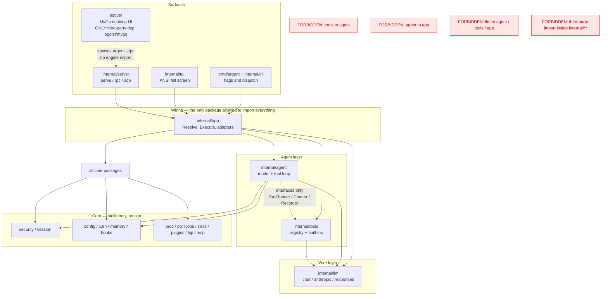
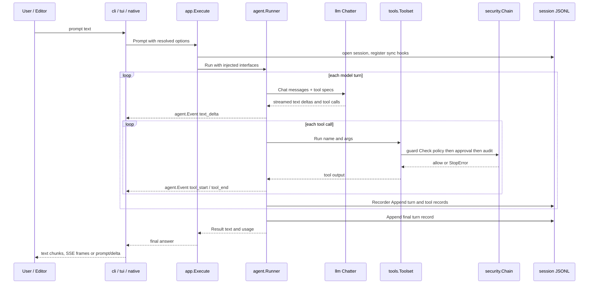
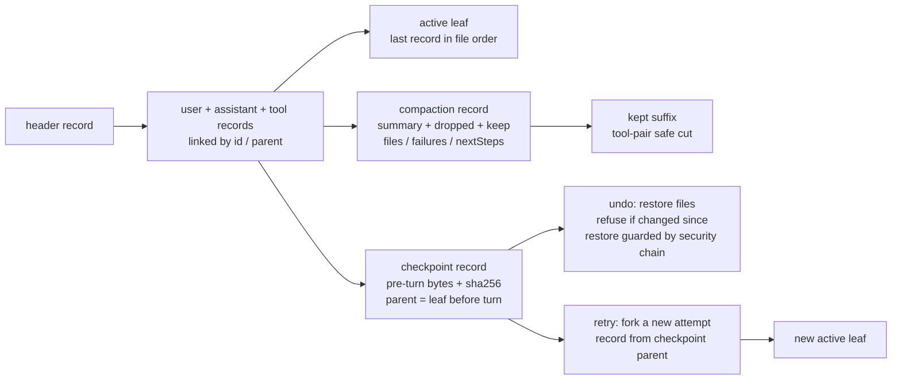
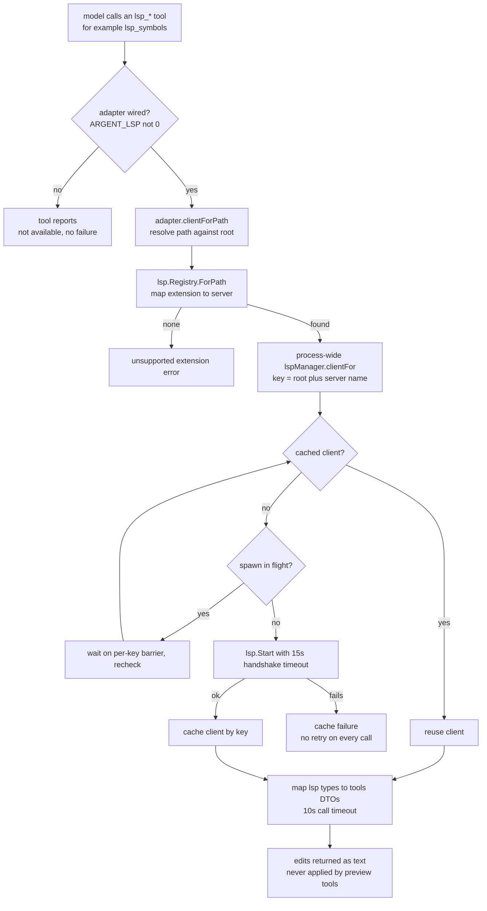
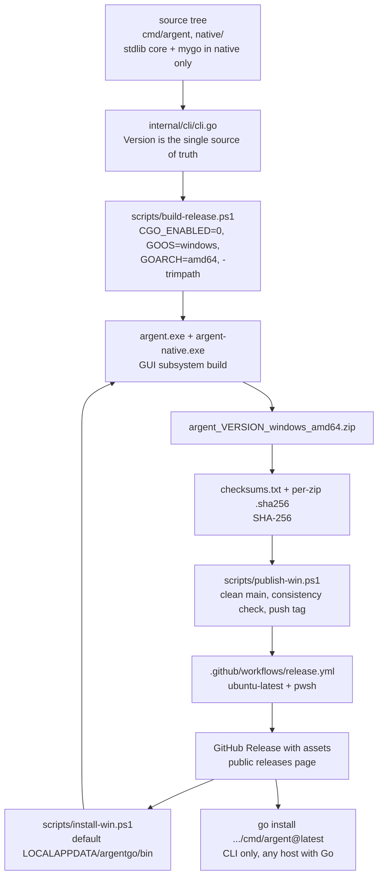

# Architecture diagrams

Companion to [ARCHITECTURE.md](ARCHITECTURE.md). The diagrams below are Mermaid
(fences are plain text) and mirror what the code and the `internal/archguard`
test actually enforce. They are a map, not a second specification: when a diagram
and the source disagree, the source wins.

## 1. Package layers and dependency rules

`internal/archguard` parses every `.go` import and checks: stdlib-only core, no
cgo, one-way layering, and a single third-party exception in `native/`.

Notes: `internal/tools` never imports `internal/agent`; `internal/agent` never
imports `internal/app`; `internal/llm` imports neither the loop nor tools;
`internal/app` is the sole wirer. `native/` is the only module that may depend on
`github.com/egoist/mygo` and reaches the engine over stdio JSON-RPC instead of
linking it.

## 2. Request flow — prompt to events

One turn, from any surface, through the single loop. `app.Execute` injects every
collaborator; the transports and TUI are interchangeable.

`--serve` emits `data:` SSE frames, `--rpc` emits `prompt/delta` notifications
plus the final `{"text":...}` result, and `acp` emits `session/update`. All three
forward the same streamed text supplied by the loop's `onText` callback.

## 3. Session tree, compaction and checkpoints

A session is one append-only JSONL file. Records carry `id` / `parent`, so a
conversation is the path from root to the active leaf and forks never rewrite
history.

`Compact(keep)` and `CompactBudget(budget)` both append a `compaction` record;
`adjustCut` keeps a tool call and its result on the same side. Checkpoints are
captured before a mutating batch and are recorded through the same
policy → approval → audit chain as a tool call.

## 4. LSP activation — lazy spawn and cached clients

Nothing is spawned at startup. The six `lsp_*` tools are always advertised; the
app installs an adapter, and a language server is only launched on the first
tool call for a given root and language.

The manager is a process-level singleton (`sync.Once`), keyed by workspace root
plus server name, so clients survive across runs and multiple write roots.
Built-in mappings cover gopls, rust-analyzer, TypeScript and pyright; a missing
binary degrades to an actionable error rather than a stall.

## 5. Distribution and install flow (Windows)

Windows/amd64 is the only published binary target. The tag alone is not a
release: the publish script waits for a published Release carrying both the zip
and the checksum manifest. `go install` produces only the CLI/engine; the desktop
client is built from `./native` and ships in the same zip as `argent.exe`.
