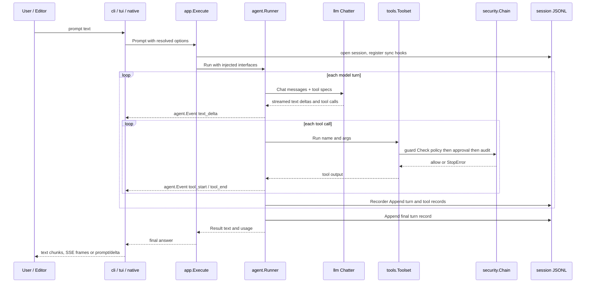
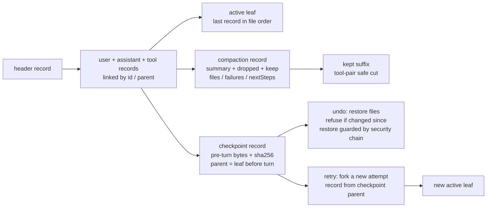
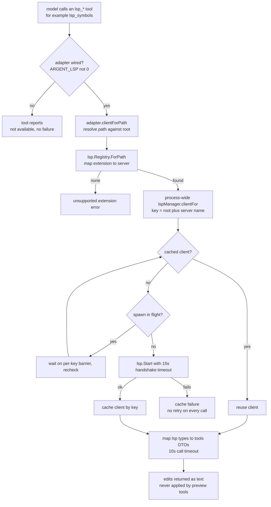
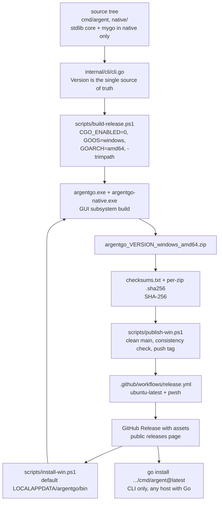

# Technical reference

`argentgo` 的架构、图示、前端决策、LSP 集成、API 表面和功能对齐。安装与分发见 [User guide](USER_GUIDE.md)；维护者与发布门禁笔记见 [CONTRIBUTING.md](../CONTRIBUTING.md)。项目方向与评分见 [STATUS.md](STATUS.md)。

## Architecture

`argentgo` 是一个分层的 agent harness：所有界面共用同一个循环，装配只发生在一处。

### 请求流

```text
任意表面                          装配              循环              边界
CLI / --serve / --rpc / acp ─┐
全屏 TUI (internal/tui)      ├─> internal/app ─> internal/agent ─> tools / security / session
原生 GUI (native/ → --rpc)  ┘        │              │                │
                                        └ 配置/provider  └ Chatter        └ JSONL 会话/审计
```

1. 入口 `cmd/argent` 构造 `cli.App` 并调用 `cli.RunWith`：解析标志、分发子命令或进入
   `runMain`。`internal/cli` 不认识 agent，只通过注入的 `RunnerFactory` 拿到 runner。
2. `internal/app` 是唯一允许 import 全部包的包。它按 `Resolve` 合并配置与 provider 模板，
   打开会话存储，为每次运行新建工具注册表、安全链和 `agent.Runner`，然后交给 loop。
3. `internal/agent` 是 provider 无关的循环：裁剪上下文、委派 `Chatter`、读取工具规格、
   执行批次、检查预算、去重、注入 steering、写 `Recorder`、发 `Event`。它只认接口。

### 注入边界

| 接口 | 定义处 | 职责 |
|---|---|---|
| `Chatter` | `internal/llm` | `Chat(ctx, model, messages, tools, onText)`；三种协议客户端实现它 |
| `ToolRunner` | `internal/agent` | `Specs()` / `Run(ctx, name, args)`；注册表与假实现都可实现 |
| `Approver` | `internal/security` | `Ask(ctx, name, args)`；交互审批、`never`、`auto` 三种实现 |
| `Recorder` | `internal/agent` | `Append(kind, payload)`；由会话的 `Append` 适配 |
| `SkillWriter` / `SkillLister` | `internal/agent` | 可选的技能自写/列举接缝；由 `internal/skills` 适配器实现 |

`internal/app.Execute` 是接线点：`Chatter` 来自 `newChatter`（含 fallback），
`ToolRunner` 是带 guard 的注册表（内置工具 + MCP + `use_skill`），
`Approver` 由审批模式选择，`Recorder` 绑定到当前会话。配置里的权限规则经
`policyFor(res)` 进入 `security.Policy`，hook 文档在 run 前后派发。事件通过
`Emit` 回传给各表面；换掉任一接口即可在测试里使用假实现，不需要网络或真实模型。

### 三种无头传输

`internal/server` 承载同一 agent 的三个入口，全部依赖注入的 `server.Runner`：

- `--serve`：`127.0.0.1:7777`（可用 `--serve-address` / `--serve-port` 改），
  Bearer token 强制；`/v1/prompt`、`/v1/events`（SSE）、`/v1/abort`、`/v1/health` 等。
- `--rpc`：stdin/stdout 上的换行分隔 JSON-RPC，`Prompt` / `Abort` / 会话方法；诊断走 stderr。
- `acp`：stdio 上的 Agent Client Protocol（`initialize`、`session/new`、`session/prompt` 等）。

三者在改循环时必须保持事件、审批与 steering 语义一致。

### 终端与图形界面

- **TUI**（`internal/tui`）：自绘 ANSI 全屏，含 streaming transcript、markdown-lite、
  输入编辑器、审批弹窗、主题与 locale；Ctrl+T/B/P 分别打开任务、工作区、计划面板；
  不经 WebView，可在 SSH 上运行。入口 `argentgo tui`。
- **GUI**（`native/`）：MyGo 原生聊天窗口，是唯一的桌面前端。它用 `ARGENT_EXE`
  拉起 `argentgo.exe --rpc`，通过 stdio JSON-RPC 驱动引擎：`prompt` + `prompt/delta`
  流式通知、`abort`、`session.list`、`session.load`。窗口由 Go 的 `ui` 包自绘，
  无 WebView、无浏览器、无 HTTP 服务。侧栏、消息列表、工具卡片、审批、
  Markdown 流式渲染都在原生控件里完成。
- **入口**（`cmd/argent/gui.go`）：`argentgo gui` 解析标志、`app.Resolve` 装配引擎，
  然后启动同目录的 `argentgo-native.exe`（GUI 子系统，无黑色控制台）。桌面只走原生窗口。

### 配置与依赖规则

配置优先级（低 → 高）：编译默认值 → `~/.argentgo/config.json` →
`<cwd>/.argent/config.json` → `<cwd>/argent.json` → profile → `ARGENT_*` → CLI 标志。
`-c/--config` 落在配置文件层（点分键嵌套），高于 env、低于 CLI 标志。

- **stdlib only（核心包）**：核心包只用标准库；`native/` 是唯一显式依赖 mygo 的模块（`go.mod` 有对应 `require`）。
- **无 cgo**：`GOOS=linux go build ./...` 必须能交叉编译。
- 只有 `internal/app` 可以 import 一切；库包可 import `internal/llm` 与标准库，
  其余依赖一律通过上面的接口注入。
- 协议细节只在 `internal/llm`；`internal/tools` 永不 import `internal/agent`。

### 发布流程（Windows）

- 唯一事实来源是 `internal/cli/cli.go` 的 `Version`；`scripts/build-release.ps1` 只校验
  `-Version`/`-Tag`，从不覆盖它，所以二进制自报版本与 tag 不会分叉。
- `scripts/check-release-consistency.ps1` 校验 Version / tag / CHANGELOG 一致，
  `scripts/privacy-scan.ps1` 扫描已跟踪文件里的高置信度密钥标记。
- `scripts/publish-win.ps1` 是单命令发布入口：校验 clean `main` 与版本一致性 →
  构建 Windows/amd64 单一 zip + checksums → 推 main 与 tag → 等 GitHub Actions
  真正发布 Release 并打印 URL；10 分钟内没有带资产的 Release 就报错。
  `-DryRun` 只做校验与本地构建，不推送。
- `.github/workflows/release.yml` 在 tag 推送后于 ubuntu-latest 上用 pwsh 构建、
  校验 checksums、从 CHANGELOG 抽取 release notes，再用 `gh release create
  --verify-tag` 上传 zip 与 checksums，并回查资产确实存在。tag 本身不是 Release。
- 本地安装/卸载用 `scripts/install-win.ps1` / `scripts/uninstall-win.ps1`
  （默认 `%LOCALAPPDATA%\argentgo\bin`），不会动 `~/.argentgo` 里的会话和配置。

### 另见

- [Diagrams](#diagrams) —— 分层、请求流、会话树、LSP 激活和分发流水线的 Mermaid 视图。
- [API reference](#api-reference) —— CLI 子命令与标志、RPC/HTTP-SSE 传输、内置工具、MCP 配置和配置分层。

## Diagrams

上文 [Architecture](#architecture) 一节的配套内容。下面的图是 Mermaid（代码围栏是纯文本），反映的是代码和 `internal/archguard` 测试实际强制的约束。它们是地图，不是第二份规范：当图与源码冲突时，以源码为准。

### 1. 包分层与依赖规则

`internal/archguard` 解析每个 `.go` 文件的 import，检查：核心只用标准库、不使用 cgo、单向分层，以及 `native/` 中唯一的第三方例外。


说明：`internal/tools` 永不 import `internal/agent`；`internal/agent` 永不 import `internal/app`；`internal/llm` 既不 import 循环也不 import 工具；`internal/app` 是唯一的装配器。`native/` 是唯一可以依赖 `github.com/egoist/mygo` 的模块，并且通过 stdio JSON-RPC 访问引擎，而不是链接它。

### 2. 请求流 —— 从 prompt 到事件

一个轮次，从任意表面出发，穿过唯一的循环。`app.Execute` 注入每个协作者；传输层和 TUI 可以互换。



`--serve` 发出 `data:` SSE 帧，`--rpc` 发出 `prompt/delta` 通知加上最终的 `{"text":...}` 结果，`acp` 发出 `session/update`。三者转发的都是循环 `onText` 回调提供的同一份流式文本。

### 3. 会话树、压缩与 checkpoint

会话是一个只追加的 JSONL 文件。记录携带 `id` / `parent`，因此一段对话就是从根到活跃叶子的路径，fork 永远不会重写历史。



`Compact(keep)` 和 `CompactBudget(budget)` 都会追加一条 `compaction` 记录；`adjustCut` 会把工具调用及其结果留在同一侧。checkpoint 在修改性批次前抓取，并像工具调用一样通过同一条策略 → 审批 → 审计链记录。

### 4. LSP 激活 —— 惰性启动与客户端缓存

启动时不会拉起任何进程。六个 `lsp_*` 工具始终对外通告；app 安装适配器，只有当某个根 + 语言首次发生工具调用时才启动语言服务器。



manager 是进程级单例（`sync.Once`），以工作区根 + 服务器名为键，因此客户端跨运行和多个写入根存活。内置映射覆盖 gopls、rust-analyzer、TypeScript 和 pyright；缺少可执行文件时会降级为可操作的错误，而不是卡住。

### 5. 分发与安装流程（Windows）



Windows/amd64 是唯一发布的二进制目标。只有 tag 不算发布：发布脚本会等待一个同时带有 zip 和校验和清单的已发布 Release。`go install` 只产出 CLI/引擎；桌面客户端从 `./native` 构建，并与 `argentgo.exe` 打进同一个 zip。

## Frontend decision

记录**当前决定**。Rust 版 `argent` 的 Tauri 壳已冻结；Go 版的前端是 **MyGo 原生 UI**，浏览器前端已完全移除。

### 决定

| 端 | 方案 | 状态 |
|---|---|---|
| 终端 | CLI 一次性运行 + `internal/tui` 自绘 ANSI 全屏；无 WebView，可跑 SSH | 已落地 |
| 图形 | **MyGo 原生 UI**（`native/`），通过 `--rpc` 驱动 `argentgo.exe` 引擎 | 唯一桌面前端 |

没有 WebView、没有浏览器、没有 HTTP+SSE 桌面桥、没有 SolidJS 前端。`ui/`、`internal/gui/`、
`internal/launcher/` 均已移除。

### 架构：两个二进制

桌面体验由两个程序组成，随 Release 一起发布：

- **`argentgo.exe`** — CLI、TUI 和 agent 引擎。`--rpc` 在 stdio 上提供换行分隔的
  JSON-RPC（`prompt` + `prompt/delta` 流式通知、`abort`、`session.list`、`session.load`）。
  核心包仍**只用标准库**。
- **`argentgo-native.exe`** — MyGo 原生聊天窗口（`native/`）。启动时用 `ARGENT_EXE`
  指向的引擎二进制拉起 `--rpc` 子进程，把用户输入作为 prompt 发出，把 delta
  通过 `Window.Update` 流式渲染。它只在桌面壳这一层依赖 `github.com/egoist/mygo`。

`argentgo gui` 在 Windows 上启动同目录的 `argentgo-native.exe`；`ARGENT_CWD` 指定工作区。

### 为什么是原生

- WebView2 渲染进程常驻约 400 MB 工作集；原生 UI 只有单进程、约 76 MB，空闲 CPU 为 0
  （MyGo 的 "settled window sleeps"）。
- MyGo 原生 UI 用 Go 的 `ui` 包绘制，无 HTML/JS/WebView；侧栏、消息列表、
  工具卡片、审批条、输入框、Markdown 流式回复都由原生控件实现。
- 引擎边界是已有的 `--rpc` 传输，不新增依赖、不改核心，核心保持 stdlib-only。

### 原生前端能力（`native/`）

- 侧栏：品牌、导航网格、会话搜索与列表、状态栏。
- 聊天：`ui.List` + follow-end，欢迎态，用户气泡，工具状态卡片，
  `markdown.View`/`markdown.Stream` 渲染助手回复。
- 交互：发送（Enter）、停止（abort）、撤销/重试（Ctrl+Z/Y）、深浅主题、
  审批 Y/N。真实引擎模式下不显示演示用的假审批。
- 无引擎时（`ARGENT_EXE` 未设置或测试）用 canned Markdown 回复，便于开发。

### 依赖约束

- 核心包（`internal/{agent,session,llm,tools,security,...}`）零第三方依赖。
- 桌面壳 `native/` 使用 MyGo（v0.x），这是唯一的第三方 Go 依赖，用于换取
  原生渲染与低内存。

### 文档

- [架构](#architecture) — 请求流、会话存储、权限、TLS、传输
- [路线图](STATUS.md#roadmap) · [功能对齐](#feature-parity) · [更新日志](../CHANGELOG.md)

## LSP 集成

`internal/lsp` 是一个只用标准库的 JSON-RPC 客户端，通过 stdio 与外部语言服务器进程讲 LSP。不捆绑任何语言服务器，也不为它添加 Go 模块：`gopls`、`rust-analyzer`、`typescript-language-server` 和 `pyright-langserver` 都是 `PATH` 上可找到的普通程序（见 `internal/lsp/servers.go` 中的 `DefaultServers()`）。缺少服务器不会破坏启动——它会在首次使用时以可操作的消息失败。

### 已实现的方法

`internal/lsp` 中的客户端实现了以下 LSP 请求。每个 `...At` 辅助函数都是便捷包装：先打开文件，再调用基于 URI 的方法。

| 方法 | 客户端辅助函数 | 文件 |
| --- | --- | --- |
| `initialize` / `initialized` + server→client request answers | `Start` / `initialize` / `answer` | `client.go` |
| `textDocument/didOpen`, `didChange`, `didSave`, `didClose` | `Open`, `Refresh`, `DidOpen`, `DidChange`, `DidSave`, `DidClose` | `documents.go` |
| `textDocument/publishDiagnostics` | `Diagnostics`, `DiagnosticsAll` | `documents.go` |
| `textDocument/definition` | `Definition`, `DefinitionAt` | `features.go` |
| `textDocument/hover` | `Hover`, `HoverAt` | `features.go` |
| `textDocument/documentSymbol` | `DocumentSymbol`, `DocumentSymbolAt` | `features_ide.go` |
| `textDocument/references` | `References`, `ReferencesAt` | `features_ide.go` |
| `textDocument/codeAction` | `CodeActions`, `CodeActionsAt` | `features_ide.go` |
| `textDocument/rename` | `Rename`, `RenameAt` | `features_ide.go` |
| `textDocument/formatting` | `Formatting`, `FormattingAt` | `features_ide.go` |
| `workspace/symbol` | `WorkspaceSymbols` | `features_ide.go` |
| `textDocument/semanticTokens/full` | `SemanticTokens`, `SemanticTokensAt` | `features_advanced.go` |
| `textDocument/inlayHint` | `InlayHints`, `InlayHintsAt` | `features_advanced.go` |
| `textDocument/codeLens`, `codeLens/resolve` | `CodeLens`, `CodeLensAt`, `ResolveCodeLens` | `features_advanced.go` |

解析器有意接受一个方法可能返回的多种线格式（单个 `Location` 与数组、`Location` 与 `LocationLink`、`DocumentSymbol` 树与扁平的 `SymbolInformation`、markup 为字符串 / `MarkupContent` / 数组），这样结果会被归一化，而不是被静默丢弃。

### 在 app 中的激活（惰性、按需）

`internal/app/lsp_adapter.go` 是休眠的客户端与 `internal/tools` 中六个 `lsp_*` 工具之间唯一的桥（`tools` 从不 import `lsp`）。

- **启动时和构建工具集时都不拉起任何进程。** 接上适配器只是让工具*可被调用*。当某个 `lsp_*` 调用解析到一个文件时，才会在**首次**调用时启动语言服务器进程，用 `Registry.ForPath(path)` 按扩展名选择服务器。
- 一个进程级的 `lspManager`（`sync.Once`）按 `root + "|" + server.Name` 缓存客户端，跨运行复用，并使用按 key 的屏障让并发调用每个 key 最多启动一个进程。启动失败会被负缓存（不会有重试风暴）；不支持的扩展名会返回清晰的错误。
- initialize 握手有界限（约 15 秒），每个请求也有界限（约 10 秒），因此坏掉的服务器会降级为工具错误，而不是挂住运行。

**关闭开关：** 设置 `ARGENT_LSP=0` 时 `NewLspIdeAdapter` 返回 `nil`；`lsp_*` 工具会持续报告 "LSP IDE integration is not available"，且绝不会启动进程。其他任何值（或未设置）都会激活适配器。

### 运行真实 server 的集成测试

`internal/lsp/gopls_integration_test.go` 通过 stdio 驱动一个**真实的 gopls** 进程。它构造一个一次性的 Go 模块，里面有一个结构体、一个常量、两个函数和一个调用点，然后测试 definition、document symbols、references、hover、workspace symbols 和 formatting。

```powershell
# needs gopls on PATH, or at %USERPROFILE%\go\bin\gopls.exe
$env:Path = "$env:USERPROFILE\.tools\go\go\bin;$env:Path"
go test ./internal/lsp -run TestIntegrationGopls -count=1 -v
```

- **优雅跳过**：当 gopls 不存在时（不在 `PATH` 上且没有 `%USERPROFILE%\go\bin\gopls.exe`），测试会跳过，所以没有 gopls 的 CI 仍保持绿色。它也会在 `go test -short` 下跳过，并且在 gopls 启动或解析定义太慢时跳过（而不是失败）——这个测试是可选的。
- 测试会定位 gopls，用 `t.Setenv` 把它的目录前置到 `PATH`，让 `lsp.Start` 中的 `exec.Command("gopls")` 能找到它，并设置 `GOFLAGS=-mod=mod` 和 `GOTOOLCHAIN=local` 来阻止网络/工具链下载。
- 直接运行 `go test ./internal/lsp` 时，只要装了 gopls 也会自动运行它；在缓存热的情况下普通运行约一秒完成。

### 哪些是硬验证，哪些是尽力而为

测试把断言分成两档，让一个可选外部工具不会让套件不稳定：

- **已验证（硬断言）。** 一旦 gopls 给出回答，测试要求结果正确：调用点上的 `DefinitionAt` 必须解析到声明行的 `main.go`（位置落在错误文件里是真正的发现，会用 `t.Errorf` 报告）；`DocumentSymbolAt` 必须包含 `RunService`、`Service`、`AppName`、`Help` 和 `main`；`ReferencesAt` 至少要返回声明和调用点。合法 fixture 的诊断必须发布（等待是尽力而为的，但干净文件只会记录日志，不做断言）。
- **尽力而为（只报告，绝不失败）。** hover 内容、`workspace/symbol` 结果和格式化编辑只记日志。空 hover、被过滤的 workspace 查询、零条格式化编辑（fixture 已经是 gofmt 格式）都是合法结果，只产生 `t.Log` 输出。

这个区分很重要：环境失败会跳过；一个成功返回但明显错误的结果才是客户端真正的 bug，会让测试失败。

### 限制

- **高级功能取决于服务器能力。** semantic tokens、inlay hints 和 code lens 都已实现并在 `initialize` 中通告，但能否返回任何内容完全取决于服务器的支持和设置。客户端保留原始 delta 编码的 semantic-token 流，解码交给 UI。`ResolveCodeLens` 无法解析那些要求回显不透明 `data` 字段的服务器的 lens，因为客户端不保留该字段。
- **按设计不支持 DAP，也不支持 tree-sitter。** Debug Adapter Protocol 和内嵌语法树解析明确不在范围内（见 `docs/STATUS.md` 的 Roadmap 一节）；本项目让原生壳保持零依赖，并通过标准库 JSON-RPC 驱动一切。
- **服务器是外部工具。** gopls（以及其他默认服务器）不由本仓库安装或 vendored。服务器之间的版本漂移可能改变 hover 文本、符号名或格式化输出；上面的硬断言被选为跨 gopls 版本稳定的那些。

## API reference

本文档描述本仓库中已实现的 `argentgo` 编程界面（版本 `0.7.0`）。它是描述性的，不是展望性的：下面每个命令、方法、工具和字段都是从代码里读出来的。进程内架构见 [Architecture](#architecture) 一节；构建与发布细节见 [Distribution](USER_GUIDE.md#distribution)。

有两个界面：

1. **CLI**（`cmd/argent` → `internal/cli`），包括无头传输 `--serve`、`--rpc` 和 `acp`；
2. 暴露给模型和外部系统的**工具 / 集成 API**（`internal/tools`、`internal/mcp`），以及把它们接起来的分层配置。

### 1. CLI 界面

`internal/cli/cli.go` 构造一个分发映射（`subcommands`），并回退到单次提示。可接受的调用形式是：

```text
argentgo [flags] <prompt>
argentgo [flags] -              # prompt read from stdin
argentgo <command> [args]
```

标志注册在 `internal/cli/flags_register.go`；权威的帮助文本是 `internal/cli/flags_usage.go` 中的 `writeUsage`。`-h/--help` 和 `-V/--version` 打印帮助和版本。版本常量是 `cli.Version = "0.7.0"`。

#### 1.1 子命令

来自 `subcommands` / `subcommandOrder` 的全部 30 个分发名称。在处理器支持的地方，`--json` 选择机器可读输出；在注明的地方，`-C <dir>` 选择工作区根。

| 命令 | 用途 | 关键参数 / 标志 |
|---|---|---|
| `sessions` | 查看已存储的会话。 | `list`, `show <id>`, `rm <id>`, `find <keyword>`, `--grep <text>`, `--limit N`, `tree <id>`, `undo <id> [-C <workspace>]`, `retry <id> [checkpoint-id]`, `name <id> <title>`, `export <id> [-o file.html]` |
| `replay` | 打印一份已存储的 transcript（没有 id 时取最近一次）。 | `[<id>] [--json]` |
| `usage` | 按会话汇总轮次、token 和工具调用。 | `[--json]` |
| `doctor` | 检查配置、存储、provider 可达性、git 和 Go。 | `[--base-url <url>]` |
| `login` | 把 API key 存进配置文件（绝不回显）。 | `<provider> [--api-key <key>] [--base-url <url>]`；也读取 `<PROVIDER>_API_KEY`、`ARGENT_API_KEY` 或 stdin |
| `logout` | 移除已存储的凭据。 | `[provider]`（不带 provider 表示移除全部） |
| `auth` | 显示凭据状态；绝不打印密钥。 | `[--json]` |
| `models` | 列出内置的 provider 模板。 | `[--json]` |
| `mcp` | 列出合并配置中声明的 MCP 服务器；不会联系任何服务器。 | `[--json] [-C <dir>]` |
| `skills` | 列出发现的 `SKILL.md` 文档。 | `[--json] [-C <dir>]` |
| `commands` | 列出发现的 markdown 斜杠命令。 | `[--json] [-C <dir>]` |
| `hooks` | 列出 hook 文档及 SHA-256 信任状态。 | `[-C <dir>]` |
| `policy` | 打印生效的沙箱、审批、provider 和策略。 | `[--json] [-C <dir>]` |
| `audit` | tail 脱敏后的审计日志。 | `[--tail <n>] [--json]` |
| `update` | 检查 GitHub release；可选地校验并安装。 | `[--check] [--apply] [--repo <owner/name>] [--current <version>] [--asset <name>] [--sha256 <hex>] [--target <path>]` |
| `completion` | 打印 shell 补全脚本。 | `bash\|zsh\|powershell` |
| `tui` | 运行全屏终端 UI。 | `[flags]`（与一次性提示模式相同的标志） |
| `bug` | 写一份不含密钥的诊断转储。 | `[--out <path>]` |
| `eval` | 运行脚本化的 JSON eval 场景。 | `<file.json>` |
| `config` | 读写点分配置键。 | `get <dotted.key>`, `set <dotted.key> <value>`, `path` |
| `workflow` | 查看并运行 workflow 定义。 | `list [-C dir] [--json]`, `show <name\|path> [-C dir]`, `run <file.json> [--input s]` |
| `telemetry` | 报告个人构建的遥测偏好（空操作）。 | `status\|off` |
| `attach` | 打印后台 job 日志的尾部。 | `<id> [-n N]` |
| `logs` | 列出后台 job 及其日志。 | `[<id>]`（`jobs` 是别名） |
| `jobs` | `logs` 的别名。 | — |
| `follow` | tail 一个 job 日志直到被打断。 | `<id> [-n N]` |
| `stop` | 杀掉一个后台 job。 | `<id>` |
| `board` | 只读查看 job 和定时自动化。 | — |
| `help` | 打印命令/标志帮助。 | — |
| `version` | 打印 `argentgo <version>`。 | — |

在这个重写版中**没有 `plugins` / `plugin` 子命令**。插件通过可重复的 `--plugins <name>` 标志按次启用（`all` 加载全部），贡献 skills、命令和 MCP 服务器；发现本身在 `internal/plugins` 中。

#### 1.2 一次性提示的标志（部分）

| 标志 | 含义 |
|---|---|
| `-m`, `--model <id>` | 模型 id（默认 `gpt-4o-mini`）。 |
| `--provider <id>` | provider 模板 id（见 `argentgo models`）。 |
| `--profile <name>`, `--list-profiles` | 选择 / 列出配置 profile。 |
| `--base-url <url>`, `--api-key <key>`, `--protocol <name>` | provider 端点、密钥和线协议（`anthropic`、`openai`、`responses`）。 |
| `-C`, `--cwd <dir>` | 工作区根（默认当前目录）。 |
| `--sandbox-mode <mode>` | `read-only`、`workspace-write`（默认）或 `danger-full-access`。 |
| `--approval <mode>` | `ask`、`never` 或 `auto`。 |
| `--yolo` | 自动批准每一次工具调用。 |
| `--max-turns`, `--max-parallel` | 轮次预算；每批只读工具的工作线程数。 |
| `--max-tokens`, `--max-cost`, `--max-seconds` | 预算停止条件。 |
| `--session <id>`, `--resume`, `--undo`, `--retry` | 会话恢复与 checkpoint 操作。 |
| `--mode text\|json`, `--json-lines` | 流式输出形态。 |
| `-c`, `--config <key=value>` | 配置覆盖，点分键嵌套（可重复）。 |
| `--serve`, `--rpc`, `--acp` | 启动一个无头传输（见 §2）。 |
| `--serve-address`, `--serve-port`, `--serve-token` | HTTP 绑定设置；serve token 必填。 |

别名与规范标志共享存储（例如 `--token` = `--serve-token`，`--session-id` = `--session`，`--continue` = `--resume`，`-V` = `--version`）。在 `flags_register.go` 中标注为 "not migrated" 的标志会被解析但不起作用。

### 2. 无头传输（`internal/server`）

三种传输都驱动同一个注入的接口：

```go
type Runner interface {
    Prompt(ctx context.Context, text string, onText func(string)) (string, error)
    Abort()
}
```

`Config` 携带 `Addr`、`Token`、`Version`、`Runner` 以及可选的 `Sessions` 存储（`List() ([]SessionInfo, error)` 和 `Load(id) ([]SessionEvent, error)`）。

#### 2.1 `--serve` —— HTTP + SSE

默认地址 `127.0.0.1:7777`（`server.DefaultAddr`），可用 `--serve-address` / `--serve-port` 覆盖。没有 token 时 `Listen` 拒绝启动（`--serve-token` 或 `ARGENT_SERVE_TOKEN`）。除 health 外的每个端点都要求在 `Authorization` 头（HTTP bearer scheme）或 `token` 查询参数中提供共享密钥；比较是常数时间的。

| 方法与路径 | 行为 |
|---|---|
| `GET /v1/health` | `{"status":"ok","version":"..."}`；无需认证。 |
| `POST /v1/prompt` | 运行一轮，响应 `Content-Type: text/event-stream`。 |
| `POST /v1/abort` | 中止当前轮次，`{"ok":true}`。 |

SSE 帧在每个 `data:` 行上是一个 JSON 对象：

```text
data: {"type":"text","text":"..."}     # streamed chunk (0..n)
data: {"type":"error","error":"..."}   # on failure, then the stream ends
data: {"type":"done"}                  # on success
```

prompt 请求体可以是纯文本、`{"text":"..."}`、`{"prompt":"..."}` 或 `{"prompt":[{"type":"text","text":"..."}]}`，由 `promptText` 处理，它是三种传输共用的单一解析器。请求体上限为 1 MiB。

#### 2.2 `--rpc` —— 换行分隔的 JSON-RPC 2.0（stdio）

`RunRPC` 从 stdin 每行读一个 JSON 对象，向 stdout 每行写一个；诊断信息走 stderr。`native/` 只通过这个传输驱动引擎（`native/bridge.go` 拉起 `argentgo --rpc`）。

| 方法 | 参数 | 结果 |
|---|---|---|
| `prompt` | `{"text":"..."}`（任意 `promptText` 载体） | `{"text":"<final answer>"}`；流式块先作为 `prompt/delta` 通知 `{"text":"..."}` 到达 |
| `abort` | 无 | `{"ok":true}` |
| `session.list` | 无 | `{"sessions":[{"id","title","updated"}, ...]}` |
| `session.load` | `{"id":"..."}` 或 `{"sessionId":"..."}` | `{"id":"...","events":[{"id","parent","kind","ts","data"}, ...]}` |

响应是 `{"jsonrpc":"2.0","id":<id>,"result":...}`；错误是 `{"jsonrpc":"2.0","id":<id>,"error":{"code":...,"message":...}}`，使用标准错误码（`-32700` parse、`-32600` invalid request、`-32601` method not found、`-32602` invalid params、`-32603` internal、`-32000` server）。通知省略 `id`。`session.load` 返回的记录形状与 JSONL 会话契约一致（`id` / `parent` / `kind` / `ts` / `data`）。

#### 2.3 `acp` —— Agent Client Protocol（stdio）

`RunACP` 是 stdio 上的 JSON-RPC 2.0，每条消息一行。方法包括：`initialize`、`authenticate`、`session/new`、`session/prompt`、`session/cancel`、`session/set_model`、`session/set_mode`。流式助手文本通过 `session/update` 通知传递；明确不支持 `session/load`。

#### 2.4 进程内事件词汇（`internal/agent/events.go`）

agent 循环发出 `agent.Event` 值，带一个 `Kind` 以及适合该 kind 的字段。前端按 `Kind` 分支；上面的传输目前用自己的更简单帧转发流式文本，而不是序列化这个结构。

| Kind | 填充的字段 |
|---|---|
| `turn_start`, `turn_end` | `Turn`, `PendingMessages` |
| `checkpoint_ready` | `Turn`, `Checkpoint`（在修改性批次前发出） |
| `text_delta` | `Turn`, `Text` |
| `reasoning_delta` | `Turn`, `Text`（整个 reasoning 块） |
| `tool_start` | `Turn`, `ToolCallID`, `ToolName`, `Args`, `Intent` |
| `tool_end` | `Turn`, `ToolCallID`, `ToolName`, `Output`, `IsError`, `DurationMS`, `Intent` |
| `usage` | `Turn`, `Usage`（本次请求）, `TotalUsage`（整个运行） |
| `error` | `Err` |
| `notice` | `Text` |
| `stop` | `Reason`, `PendingMessages` |
| `subagent_start` | `Text`, `ToolName`, `Depth` |
| `subagent_end` | `Text`, `Output`, `IsError`, `Err`, `Depth` |

根运行的 `Depth` 为 0，委派的子代理依次递增。

### 3. 工具 API（`internal/tools`）

一个工具实现 `Name() string`、`Description() string`、`Schema() string`、`Mutating() bool` 和 `Run(ctx, root, args json.RawMessage)`。`Registry` 持有工具，强制工作区边界（`resolve` 拒绝 `..` 和绝对路径逃逸），在每次调用前运行 guard，并默认把输出裁剪到 40000 个字符。`Specs()` 把每个工具暴露为一个 `llm.ToolSpec` 函数 schema。工具描述在过线前会裁剪到 1024 个 rune。

#### 3.1 已注册的内置工具

注册顺序来自 `tools_registry.go:NewWithLimit`。**M** 表示 `Mutating() == true`，因此调用会走安全链（策略 → 审批 → 审计），并在 `read-only` 沙箱模式下隐藏；标记为 **R** 的工具是只读的（`Mutating() == false`）。在没有 `--yolo` 时对 M 工具的调用也会被注册表拒绝。关键参数取自各自的 `Schema()`。

| 工具 | M/R | 用途 | 关键参数 |
|---|---|---|---|
| `read` | R | 读取 UTF-8 文本文件；用 `offset`/`limit` 分页。 | `path`（必填）, `offset`, `limit` |
| `write` | **M** | 创建或覆盖文件。 | `path`, `content`（必填） |
| `edit` | **M** | 替换唯一的旧文本匹配。 | `path`, `old`/`new`（或 `old_text`/`new_text`）, `repair`, `anchor`, `anchor_hash`, `hashline` |
| `bash` | **M** | 在工作区根运行 shell 命令。 | `command`（必填）, `timeout_seconds`, `background_after_ms` |
| `ls` | R | 列出目录。 | `path` |
| `grep` | R | 用正则搜索文件内容。 | `pattern`（必填）, `path` |
| `find` | R | 按名称 glob 查找文件。 | `pattern`（必填）, `path` |
| `powershell` | **M** | 在 Windows 上运行 PowerShell 脚本。 | `command` 或 `script`, `timeout_seconds` |
| `glob` | R | 按路径 glob 查找文件，如 `**/*.go`。 | `pattern`（必填）, `path` |
| `todo` | R | 维护会话任务列表。 | `op`（`write`/`read`）, `todos[]`（`id`, `text`, `status`） |
| `multi_edit` | **M** | 对一个文件应用多个有序替换；全部必须匹配。 | `path`, `edits[]`（`old`/`new`）, `repair` |
| `web_fetch` | R | 以纯文本抓取 http(s) URL。 | `url`（必填）, `allowLocal` |
| `git_status` | R | `git status --short --branch`。 | 无 |
| `current_time` | R | 当前 UTC/时区时间。 | `timezone`, `format`（`rfc3339`/`date`/`time`/`unix`） |
| `web_search` | R | 通过可选的 `ARGENT_WEB_SEARCH_URL` 端点搜索。 | `query`（必填）, `limit` |
| `repo_map` | R | 映射工作区目录、文件和排序后的 Go 符号。 | `path`, `mention`, `mentions[]`, `symbols` |
| `submit_plan` | R | 把计划步骤存为 `plan.json`；绝不执行它们。 | `steps[]`, `status` |
| `lsp_symbols` | R | 文档符号（函数、类型、方法、变量）。 | `path`（必填） |
| `lsp_references` | R | 某个位置上符号的引用。 | `path`, `line`, `character`, `includeDeclaration` |
| `lsp_code_actions` | R | 某个范围的快速修复 / 重构。 | `path`, `startLine`, `startChar`, `endLine`, `endChar` |
| `lsp_rename_preview` | R | 重命名工作区编辑的**只读预览**；返回文本，绝不应用。 | `path`, `line`, `character`, `newName` |
| `lsp_format` | R | 格式化文本编辑的**只读预览**；绝不应用。 | `path`, `tabSize`, `insertSpaces` |
| `lsp_workspace_symbols` | R | 全工作区符号搜索。 | `query`（必填） |
| `memory_retain` | **M** | 把一条持久事实存入跨会话记忆库（先脱敏）。 | `text`（必填）, `tags[]`, `source` |
| `memory_recall` | R | 按词重叠和标签搜索记忆库。 | `query`, `tags[]`, `limit` |
| `memory_forget` | **M** | 按 id 移除一条记忆。 | `id`（必填） |
| `tool_search` | R | 按名称/描述相关性查找最多 20 个工具。 | `query`（必填）, `limit` |

说明：

- 每个 schema 还接受一个 `i` 字符串（每次调用的简短意图），由 `internal/agent/tool_intent.go` 注入；它会出现在工具事件上。
- `lsp_code_actions`、`lsp_rename_preview` 和 `lsp_format` 是预览：它们提出编辑但绝不写文件。用 `edit`/`write` 来应用。在 app 安装 LSP 适配器之前，六个 `lsp_*` 工具都会报告 "not available"。
- `internal/app` 额外通告一个工具 `use_skill`（`internal/skills/tool.go`，参数 `name`），按需加载 `SKILL.md` 正文。MCP 工具以 `server__tool` 形式追加（见 §4）。

还有三个工具以可选构造函数的形式存在，但**不在**默认注册表中，普通运行也不会通告它们：`checkpoint_diff`（`SetCheckpointSource`）、`memory_reflect` 和 `memory_learn`（`MemoryAdvancedTools`）。

### 4. MCP 集成（`internal/mcp`）

服务器在合并配置的 `mcpServers` 键下声明（§5）。该键既可以是以服务器名为键的对象，也可以是带 `name` 字段的对象数组；权限字段同时接受 camelCase 和 snake_case 拼写。格式错误的条目会被跳过并给出警告，而不是让整个配置失败（`DecodeConfig`）。

| 字段 | 含义 |
|---|---|
| `name` | 服务器 id；把它的工具命名空间化为 `server__tool`。对象形式必填。 |
| `command`, `args`, `env` | stdio 程序、参数以及额外的 `KEY=VALUE` 环境项。 |
| `url`, `headers` | HTTP 端点和额外的头。 |
| `transport` | `stdio` 或 `http`（接受 `sse`）；为空时按 `command` 与 `url` 推断。 |
| `timeout` | 每次请求的秒数（默认 30s）。 |
| `enabled` | 默认为 true；显式 false 会禁用该服务器。 |
| `readOnly` | 在任何请求发出前，拦截看起来是修改性的工具调用。 |
| `allowedTools`, `deniedTools` | 工具白名单 / 黑名单；拒绝优先于允许。 |

运行时还会合并额外来源（`internal/app/mcp.go`）：来自已启用插件包的 MCP 服务器，以及 `<workspace>/.argent/mcp.json`——后者**只有**在设置 `--trust-project` 时才会读取。握手限制在 5 秒内，失败采用失败即软处理：坏掉的服务器只报告一次并跳过。

`argentgo mcp [--json] [-C <dir>]` 会从合并配置中列出已配置的服务器（名称、传输、目标）。它不会联系任何服务器。

#### 实用配置示例

以下是三个经过核对的 stdio 配方，复制到任一配置层的 `mcpServers` 即可；**默认零 server**，改完需重启进程。完整话术、前置依赖与风险分析见 [MCP_RECIPES.md](MCP_RECIPES.md)。字段名以 `internal/mcp/config.go` 的解码器为准：`command`/`args`/`env`/`url`/`headers`/`transport`/`timeout`/`enabled`/`readOnly`/`allowedTools`/`deniedTools`（权限字段亦接受 snake_case）；**没有 `type` 字段**（VS Code 的 `"type": "stdio"` 会被忽略），用 `transport`。

**① 文档解析（PDF/Office → Markdown，最高价值）** —— `markitdown-mcp` 只暴露 `convert_to_markdown(uri)`，输出 Markdown 文本，直接补"模型看不见非文本"的断层。触发："把 `file:///D:/docs/季度报告.pdf` 转成 Markdown，只保留标题和表格。"前置：安装 `uv`（提供 `uvx`，Python ≥3.10）。安全：`readOnly` 不误伤（工具名无写动词）；`uri` 可指向 http(s)，建议只喂本地 `file://`；扫描版 PDF 无文本层会返回空；大文件整篇返回需限幅。

```json
{
  "mcpServers": {
    "markitdown": {
      "command": "uvx",
      "args": ["markitdown-mcp"],
      "readOnly": true,
      "allowedTools": ["convert_to_markdown"]
    }
  }
}
```

**② 浏览器 snapshot（可访问性树文本）** —— Playwright MCP 用 accessibility tree 而非截图，返回纯文本，绕开图片占位符缺陷。**stdio 是默认传输，官方 CLI 没有 `--stdio` 参数**（加了会以未知参数报错；切 HTTP 用 `--port`）。只白名单三个观察工具，拒绝优先于允许。触发："打开 example.com，用 `browser_snapshot` 读出可访问性树，列出主导航。"前置：Node.js ≥20。安全：页面文本是未信输入，prompt injection 是头号风险——禁用 `browser_evaluate`（任意 JS）与 `browser_run_code_unsafe`（等价 RCE）；`readOnly` 只是工具名动词启发式，`browser_navigate` 不在写动词表内，真正约束靠白名单。

```json
{
  "mcpServers": {
    "playwright": {
      "command": "npx",
      "args": ["@playwright/mcp@latest", "--headless", "--isolated", "--image-responses=omit"],
      "readOnly": true,
      "allowedTools": ["browser_navigate", "browser_snapshot", "browser_console_messages"],
      "deniedTools": ["browser_evaluate", "browser_run_code_unsafe", "browser_take_screenshot"]
    }
  }
}
```

**③ 只读数据库** —— SQLite 用官方参考 server 指向副本；`read_query`/`list_tables`/`describe-table` 放行，`write_query`/`create_table`/`append_insight` 被 `readOnly` 与黑名单双重拦截。触发："列出表，再统计 `orders` 每月订单数。"前置：`uvx` + 数据库副本（再在 OS 层设只读）。Postgres 用 `dbhub --readonly`，DSN 写 `{env:DB_DSN}`（加载时替换，凭据不进配置/git）。安全：该 server 自身无只读模式，靠副本 + 文件权限 + DB 只读角色兜底；查询结果会进入会话日志。

```json
{
  "mcpServers": {
    "sqlite": {
      "command": "uvx",
      "args": ["mcp-server-sqlite", "--db-path", "D:/data/analytics-copy.db"],
      "readOnly": true,
      "allowedTools": ["read_query", "list_tables", "describe-table"],
      "deniedTools": ["write_query", "create_table", "append_insight"]
    }
  }
}
```

局限：`CallTool` 把 `image` 内容块降级为 `[image: <mime>]` 占位符（`mcp.go:463-469`），模型看不到真实图像，故选文本化输出的 server；`readOnly` 非沙箱；HTTP/SSE 的 endpoint 宣告仅接受同源（`http.go` 的 `resolveEndpoint`），避免配 `headers` 时跨源泄漏；Windows 上 `.ps1` 命令会自动用 PowerShell 包装（`stdio.go` 的 `execSpecForOS`）。

### 5. 配置（`internal/config`）

#### 5.1 优先级与位置

从低到高的优先级：

1. 编译默认值（`model=gpt-4o-mini`、`protocol=openai-chat-completions`、`sandboxMode=workspace-write`、`maxTurns=12`、`locale=en-US`、存储位于 home 目录下）；
2. `~/.argentgo/config.json`（home 从 `HOME` 或 `USERPROFILE` 解析）；
3. `<cwd>/.argent/config.json`；
4. `<cwd>/argent.json`；
5. 选中的 profile；
6. `ARGENT_*` 环境变量；
7. 显式的标志覆盖（`-c` / `--config`）。

对象递归合并；数组和标量替换。文件可以使用 JSONC（注释和尾随逗号）以及 `{env:VAR}` / `{file:path}` 引用；相对的 `{file:}` 路径按配置文件所在目录解析。

#### 5.2 Profile 与环境变量

profile 用 `ARGENT_PROFILE` 或 `profile` / `activeProfile` 键选择，并在任意文件层的 `profiles` 下内联定义；当存在 profiles 时，未知名称会报错。可识别的环境覆盖包括 `ARGENT_MODEL`、`ARGENT_BASE_URL`、`ARGENT_API_KEY`、`ARGENT_PROTOCOL`、`ARGENT_LOCALE`、`ARGENT_SANDBOX_MODE`、`ARGENT_STORAGE_DIR`、`ARGENT_PROVIDER`、`ARGENT_MAX_TURNS` 和 `ARGENT_YOLO`。`-c key=value` 的覆盖在点分键上嵌套（例如 `-c models.gpt-4o.contextWindow=128000`），位于所有文件和环境层之上。

存储默认在 `<home>/.argentgo`；会话在它的 `sessions/` 子目录里。可用 `ARGENT_STORAGE_DIR` 或 `ARGENT_HOME` 覆盖。

#### 5.3 版本字面量

版本字符串 `0.7.0` 出现在三个源码字面量中，必须一起升级：

| 文件 | 符号 / 用途 |
|---|---|
| `internal/cli/cli.go` | `const Version` —— `--version`、`/v1/health`、ACP `initialize`；打包脚本读这一个。 |
| `internal/mcp/mcp.go` | `clientVersion` —— MCP `clientInfo.version`。 |
| `internal/lsp/client.go` | LSP `initialize` 请求 `clientInfo` 中的 `version`。 |

`scripts/build-release.ps1` 只针对 `cli.Version` 校验 `-Version` / `-Tag`；它不检查另外两个。发布门禁细节见 [Distribution](USER_GUIDE.md#version-locations)。

## Feature parity

基准：`argent` v0.4.0（已冻结）。清单由源码生成，不是凭记忆（最近核对：R43）：

- flag：`crates/cli/src/args.rs` 的 57 个字段
- 子命令：`crates/cli/src/commands.rs` 的 27 个分支
- 工具：`crates/tools/src/*.rs` 的 `fn name()` 共 21 个

状态：`done` 已迁移并通过测试 · `in progress` 有代码/后端已落地但仍待接线 ·
`parse-then-error` 解析后明确报错退出 · `todo` 未开始 · `skip` 明确不迁（附理由）

### 工具（21）

| Rust | Go | 状态 | 说明 |
|---|---|---|---|
| read write edit bash ls grep find | 同名 | done | |
| apply_patch | multi_edit | done | 语义等价：多段替换一次写入 |
| todo | todo | done | |
| glob（Rust 走 find/grep） | glob | done | |
| web_search | `web_search` | done | 可配置 `ARGENT_WEB_SEARCH_URL`；未配置时明确建议 `web_fetch` |
| current_time | `current_time` | done | UTC/本地/IANA 时区，RFC3339/date/time/unix |
| delegate | agent 的 `task` | done | 子代理/嵌套循环已落地 |
| memory | 项目记忆注入 | done | 以 system prompt 注入实现，非独立可调用工具 |
| skill | `use_skill` | done | SKILL.md 发现 + 渐进披露已接线 |
| tool_search | `tool_search` | done | 按名称/描述检索注册工具 |
| submit_plan | `submit_plan` | done | 会话目录写入 plan.json，不执行步骤 |
| code | — | skip | 等价于 bash + 临时文件，重复 |
| document | — | skip | office 预览只服务桌面端 |
| repo_map | LSP documentSymbol | done | 不用 tree-sitter，走 LSP 符号 |
| probe | — | skip | 实验性自检工具，无用户面 |
| ask | 审批链路 | n/a | Go 里审批是通道，不是工具 |

### CLI flag（57）

done（已落地并生效）：

`prompt model mode json_lines cwd base_url api_key yolo max_turns approval locale
config_overrides rpc serve serve_port serve_token acp help version provider profile
list_profiles list_sessions list_models sandbox max_tokens max_cost max_seconds
price_input price_output fallback_model tokens trust_project thinking
no_auto_compact plugins add_dir resume continue_session secondary_model`

parse-then-error（解析成功但明确报错退出，exit 1，不静默忽略）：

`worktree background enable_browser enable_desktop enable_service workflow_mode
workflow_resume workflow_journal gui`

- `--worktree`：自行创建 worktree 后用 `-C` 指定
- `--background`：用外部进程管理器托管
- `--enable-browser` / `--enable-desktop` / `--enable-service`：对应工具未移植
- `--workflow-mode` / `--workflow-resume` / `--workflow-journal`：journal 未移植；
  可自行调用 `internal/workflow`
- `gui`：作为 flag 会报 not migrated 并以 exit 1 退出；GUI 经 `argentgo gui` 子命令启动，现已可用

in progress（能解析，行为仍待接线）：

`theme no_color output_schema`

- `theme` / `no_color`：TUI 主题切换仍在进行中
- `output_schema`：schema 已加载进 system prompt，失败重试/校验仍在补齐

（`add_dir`：扩展可写根目录已由 `security.WriteRootsFrom` 落地，见 `internal/app/app_resolve.go:176-208`，有测试；
`resume`（含 `--continue` / `--continue-session` 别名）：会话恢复由 `internal/app/sessions.go:13-36` 实现，有测试。两者已移入 done。）

skip（按设计不做 flag）：

- `serve_prompt` → 由 `--serve` 的运行参数承载，无独立 flag
- `doctor` `workflow` `workflow_resume` `workflow_journal` → 改为子命令（Rust 是双入口，Go 只留子命令）
- `serve_address` → 用 `--serve-port` + 配置项
- `sandbox` → `--sandbox-mode` 的别名（保留兼容，非独立 flag）

### 子命令（27）

done（已分发并通过测试）：

`sessions doctor login eval logout auth models mcp skills commands hooks audit usage
policy update completion replay bug config tui workflow telemetry attach logs follow stop board`

（Go 另有 `help` / `version` 两个入口，等价于 `-h` / `-V`。）

### 子系统

| 子系统 | Go 包 | 状态 |
|---|---|---|
| 3 套协议（Anthropic / chat / Responses） | `internal/llm` | done |
| provider 模板 | `internal/provider` | done |
| agent 循环（预算/裁剪/去重/steering/子代理） | `internal/agent` | done |
| 工具注册表 + guard | `internal/tools` | done |
| 策略 / 审批 / 审计 / 沙箱 | `internal/security` | done |
| 会话树 / fork / 压缩 | `internal/session` | done |
| 分层配置 / profiles | `internal/config` | done |
| MCP（stdio / HTTP-SSE） | `internal/mcp` | done |
| hooks（11 事件 + 信任） | `internal/hooks` | done |
| 插件清单发现 / 安装 | `internal/plugins` | done（marketplace 不迁） |
| LSP | `internal/lsp` | done |
| skills / commands / memory / i18n | 同名 | done |
| TUI | `internal/tui` | done |
| CLI + `--serve` / `--rpc` / `acp` | `internal/cli` `internal/server` | done |
| pty / jobs / 进程控制 | `internal/proc` `pty` `jobs` | done |
| automation / workflow | 同名 | done |
| auth（PKCE / 设备码）/ update | 同名 | done |
| eval 场景 | `internal/eval` | done |
| 装配层 | `internal/app` | done |
| 原生 C-ABI 插件加载器 | 进程插件 | skip（Go 无该生态） |
| tree-sitter AST | LSP 符号 | skip（cgo 会破坏静态交叉编译） |
| Rhai 脚本插件 | — | skip（明确不迁） |
| device（桌面控制） | — | skip |
| telemetry | — | skip（个人项目无收益；子命令仍 in progress） |
| 安全策略规则（用户配置） | `internal/app/policy_config.go` | done：配置规则进入 `security.Policy` |
| hooks 运行时派发 | `internal/app/hooks.go` | done：7 事件接入真实 run，exit-2 阻断工具 |
| MCP per-server 权限 | `internal/mcp` | done：enabled/readOnly/allowedTools/deniedTools |
| TUI tasks/workspace/plan 面板 | `internal/tui` | done：Ctrl+T/B/P |
| 桌面壳（原生） | `native/`（MyGo） | done：纯 Go 原生 UI，经 `--rpc` 驱动引擎，无 WebView |

### 验收规则（不靠文档靠测试）

1. `internal/cli/parity_test.go`：断言 flag 表、子命令表与上面的 done 集合一致；少一个即红。
2. `evals/core.json` 移植后，同一批场景在 Go 上跑通，通过率必须与 Rust 版一致。
3. 每轮集成先 `go vet ./...` + `go test ./...`，再对表勾状态。

这份清单是「还差什么」的唯一来源；代码里的 `TODO` 不算。
