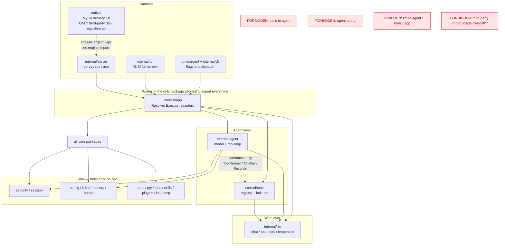
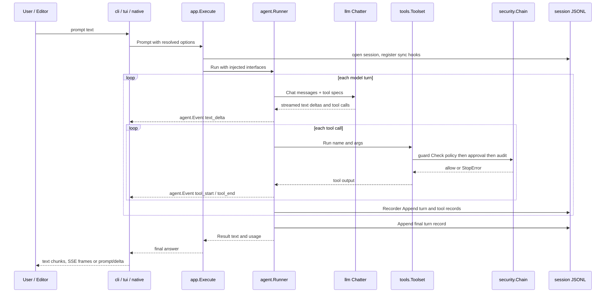
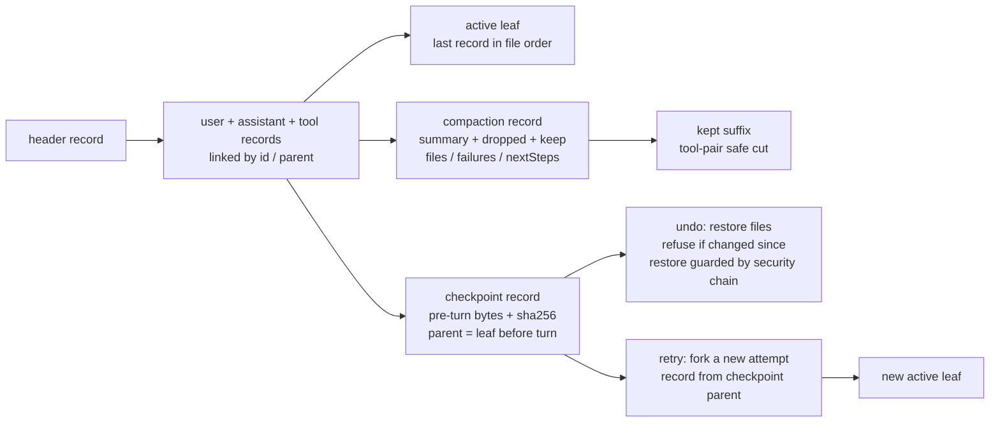
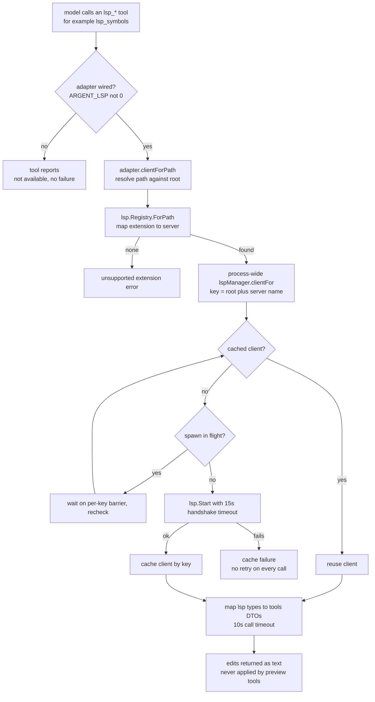
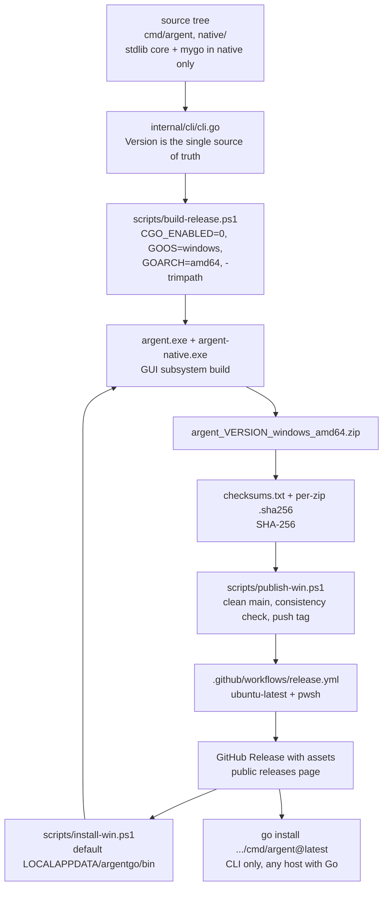

# Technical reference

Architecture, diagrams, frontend decision, LSP integration, API surface and
feature parity for `argentgo`. Installation and distribution live in the
[User guide](USER_GUIDE.md); maintainer and release-gate notes live in
[CONTRIBUTING.md](../CONTRIBUTING.md). Project direction and scoring live in
[STATUS.md](STATUS.md).

## Architecture

`argentgo` 是一个分层的 agent harness：所有界面共用同一个循环，装配只发生在一处。

### 请求流

```text
任意表面                          装配              循环              边界
CLI / --serve / --rpc / acp ─┐
全屏 TUI (internal/tui)      ├─> internal/app ─> internal/agent ─> tools / security / session
原生 GUI (native/ → --rpc)  ┘        │              │                │
                                        └ 配置/provider  └ Chatter        └ JSONL 会话/审计
```

1. 入口 `cmd/argent` 构造 `cli.App` 并调用 `cli.RunWith`：解析标志、分发子命令或进入
   `runMain`。`internal/cli` 不认识 agent，只通过注入的 `RunnerFactory` 拿到 runner。
2. `internal/app` 是唯一允许 import 全部包的包。它按 `Resolve` 合并配置与 provider 模板，
   打开会话存储，为每次运行新建工具注册表、安全链和 `agent.Runner`，然后交给 loop。
3. `internal/agent` 是 provider 无关的循环：裁剪上下文、委派 `Chatter`、读取工具规格、
   执行批次、检查预算、去重、注入 steering、写 `Recorder`、发 `Event`。它只认接口。

### 注入边界

| 接口 | 定义处 | 职责 |
|---|---|---|
| `Chatter` | `internal/llm` | `Chat(ctx, model, messages, tools, onText)`；三种协议客户端实现它 |
| `ToolRunner` | `internal/agent` | `Specs()` / `Run(ctx, name, args)`；注册表与假实现都可实现 |
| `Approver` | `internal/security` | `Ask(ctx, name, args)`；交互审批、`never`、`auto` 三种实现 |
| `Recorder` | `internal/agent` | `Append(kind, payload)`；由会话的 `Append` 适配 |
| `SkillWriter` / `SkillLister` | `internal/agent` | 可选的技能自写/列举接缝；由 `internal/skills` 适配器实现 |

`internal/app.Execute` 是接线点：`Chatter` 来自 `newChatter`（含 fallback），
`ToolRunner` 是带 guard 的注册表（内置工具 + MCP + `use_skill`），
`Approver` 由审批模式选择，`Recorder` 绑定到当前会话。配置里的权限规则经
`policyFor(res)` 进入 `security.Policy`，hook 文档在 run 前后派发。事件通过
`Emit` 回传给各表面；换掉任一接口即可在测试里使用假实现，不需要网络或真实模型。

### 三种无头传输

`internal/server` 承载同一 agent 的三个入口，全部依赖注入的 `server.Runner`：

- `--serve`：`127.0.0.1:7777`（可用 `--serve-address` / `--serve-port` 改），
  Bearer token 强制；`/v1/prompt`、`/v1/events`（SSE）、`/v1/abort`、`/v1/health` 等。
- `--rpc`：stdin/stdout 上的换行分隔 JSON-RPC，`Prompt` / `Abort` / 会话方法；诊断走 stderr。
- `acp`：stdio 上的 Agent Client Protocol（`initialize`、`session/new`、`session/prompt` 等）。

三者在改循环时必须保持事件、审批与 steering 语义一致。

### 终端与图形界面

- **TUI**（`internal/tui`）：自绘 ANSI 全屏，含 streaming transcript、markdown-lite、
  输入编辑器、审批弹窗、主题与 locale；Ctrl+T/B/P 分别打开任务、工作区、计划面板；
  不经 WebView，可在 SSH 上运行。入口 `argent tui`。
- **GUI**（`native/`）：MyGo 原生聊天窗口，是唯一的桌面前端。它用 `ARGENT_EXE`
  拉起 `argent.exe --rpc`，通过 stdio JSON-RPC 驱动引擎：`prompt` + `prompt/delta`
  流式通知、`abort`、`session.list`、`session.load`。窗口由 Go 的 `ui` 包自绘，
  无 WebView、无浏览器、无 HTTP 服务。侧栏、消息列表、工具卡片、审批、
  Markdown 流式渲染都在原生控件里完成。
- **入口**（`cmd/argent/gui.go`）：`argent gui` 解析标志、`app.Resolve` 装配引擎，
  然后启动同目录的 `argent-native.exe`（GUI 子系统，无黑色控制台）。桌面只走原生窗口。

### 配置与依赖规则

配置优先级（低 → 高）：编译默认值 → `~/.argentgo/config.json` →
`<cwd>/.argent/config.json` → `<cwd>/argent.json` → profile → `ARGENT_*` → CLI 标志。
`-c/--config` 落在配置文件层（点分键嵌套），高于 env、低于 CLI 标志。

- **stdlib only（核心包）**：核心包只用标准库；`native/` 是唯一显式依赖 mygo 的模块（`go.mod` 有对应 `require`）。
- **无 cgo**：`GOOS=linux go build ./...` 必须能交叉编译。
- 只有 `internal/app` 可以 import 一切；库包可 import `internal/llm` 与标准库，
  其余依赖一律通过上面的接口注入。
- 协议细节只在 `internal/llm`；`internal/tools` 永不 import `internal/agent`。

### 发布流程（Windows）

- 唯一事实来源是 `internal/cli/cli.go` 的 `Version`；`scripts/build-release.ps1` 只校验
  `-Version`/`-Tag`，从不覆盖它，所以二进制自报版本与 tag 不会分叉。
- `scripts/check-release-consistency.ps1` 校验 Version / tag / CHANGELOG 一致，
  `scripts/privacy-scan.ps1` 扫描已跟踪文件里的高置信度密钥标记。
- `scripts/publish-win.ps1` 是单命令发布入口：校验 clean `main` 与版本一致性 →
  构建 Windows/amd64 单一 zip + checksums → 推 main 与 tag → 等 GitHub Actions
  真正发布 Release 并打印 URL；10 分钟内没有带资产的 Release 就报错。
  `-DryRun` 只做校验与本地构建，不推送。
- `.github/workflows/release.yml` 在 tag 推送后于 ubuntu-latest 上用 pwsh 构建、
  校验 checksums、从 CHANGELOG 抽取 release notes，再用 `gh release create
  --verify-tag` 上传 zip 与 checksums，并回查资产确实存在。tag 本身不是 Release。
- 本地安装/卸载用 `scripts/install-win.ps1` / `scripts/uninstall-win.ps1`
  （默认 `%LOCALAPPDATA%\argentgo\bin`），不会动 `~/.argentgo` 里的会话和配置。

### See also

- [Diagrams](#diagrams) — Mermaid views of the layers, request flow, session tree,
  LSP activation and distribution pipeline.
- [API reference](#api-reference) — CLI subcommands and flags, RPC/HTTP-SSE
  transports, built-in tools, MCP configuration and config layering.

## Diagrams

Companion to the [Architecture](#architecture) section above. The diagrams below
are Mermaid (fences are plain text) and mirror what the code and the
`internal/archguard` test actually enforce. They are a map, not a second
specification: when a diagram and the source disagree, the source wins.

### 1. Package layers and dependency rules

`internal/archguard` parses every `.go` import and checks: stdlib-only core, no
cgo, one-way layering, and a single third-party exception in `native/`.



Notes: `internal/tools` never imports `internal/agent`; `internal/agent` never
imports `internal/app`; `internal/llm` imports neither the loop nor tools;
`internal/app` is the sole wirer. `native/` is the only module that may depend on
`github.com/egoist/mygo` and reaches the engine over stdio JSON-RPC instead of
linking it.

### 2. Request flow — prompt to events

One turn, from any surface, through the single loop. `app.Execute` injects every
collaborator; the transports and TUI are interchangeable.



`--serve` emits `data:` SSE frames, `--rpc` emits `prompt/delta` notifications
plus the final `{"text":...}` result, and `acp` emits `session/update`. All three
forward the same streamed text supplied by the loop's `onText` callback.

### 3. Session tree, compaction and checkpoints

A session is one append-only JSONL file. Records carry `id` / `parent`, so a
conversation is the path from root to the active leaf and forks never rewrite
history.



`Compact(keep)` and `CompactBudget(budget)` both append a `compaction` record;
`adjustCut` keeps a tool call and its result on the same side. Checkpoints are
captured before a mutating batch and are recorded through the same
policy → approval → audit chain as a tool call.

### 4. LSP activation — lazy spawn and cached clients

Nothing is spawned at startup. The six `lsp_*` tools are always advertised; the
app installs an adapter, and a language server is only launched on the first
tool call for a given root and language.



The manager is a process-level singleton (`sync.Once`), keyed by workspace root
plus server name, so clients survive across runs and multiple write roots.
Built-in mappings cover gopls, rust-analyzer, TypeScript and pyright; a missing
binary degrades to an actionable error rather than a stall.

### 5. Distribution and install flow (Windows)



Windows/amd64 is the only published binary target. The tag alone is not a
release: the publish script waits for a published Release carrying both the zip
and the checksum manifest. `go install` produces only the CLI/engine; the desktop
client is built from `./native` and ships in the same zip as `argent.exe`.

## Frontend decision

记录**当前决定**。Rust 版 `argent` 的 Tauri 壳已冻结；Go 版的前端是 **MyGo 原生 UI**，
浏览器前端已完全移除。

### 决定

| 端 | 方案 | 状态 |
|---|---|---|
| 终端 | CLI 一次性运行 + `internal/tui` 自绘 ANSI 全屏；无 WebView，可跑 SSH | 已落地 |
| 图形 | **MyGo 原生 UI**（`native/`），通过 `--rpc` 驱动 `argent.exe` 引擎 | 唯一桌面前端 |

没有 WebView、没有浏览器、没有 HTTP+SSE 桌面桥、没有 SolidJS 前端。`ui/`、`internal/gui/`、
`internal/launcher/` 均已移除。

### 架构：两个二进制

桌面体验由两个程序组成，随 Release 一起发布：

- **`argent.exe`** — CLI、TUI 和 agent 引擎。`--rpc` 在 stdio 上提供换行分隔的
  JSON-RPC（`prompt` + `prompt/delta` 流式通知、`abort`、`session.list`、`session.load`）。
  核心包仍**只用标准库**。
- **`argent-native.exe`** — MyGo 原生聊天窗口（`native/`）。启动时用 `ARGENT_EXE`
  指向的引擎二进制拉起 `--rpc` 子进程，把用户输入作为 prompt 发出，把 delta
  通过 `Window.Update` 流式渲染。它只在桌面壳这一层依赖 `github.com/egoist/mygo`。

`argent gui` 在 Windows 上启动同目录的 `argent-native.exe`；`ARGENT_CWD` 指定工作区。

### 为什么是原生

- WebView2 渲染进程常驻约 400 MB 工作集；原生 UI 只有单进程、约 76 MB，空闲 CPU 为 0
  （MyGo 的 "settled window sleeps"）。
- MyGo 原生 UI 用 Go 的 `ui` 包绘制，无 HTML/JS/WebView；侧栏、消息列表、
  工具卡片、审批条、输入框、Markdown 流式回复都由原生控件实现。
- 引擎边界是已有的 `--rpc` 传输，不新增依赖、不改核心，核心保持 stdlib-only。

### 原生前端能力（`native/`）

- 侧栏：品牌、导航网格、会话搜索与列表、状态栏。
- 聊天：`ui.List` + follow-end，欢迎态，用户气泡，工具状态卡片，
  `markdown.View`/`markdown.Stream` 渲染助手回复。
- 交互：发送（Enter）、停止（abort）、撤销/重试（Ctrl+Z/Y）、深浅主题、
  审批 Y/N。真实引擎模式下不显示演示用的假审批。
- 无引擎时（`ARGENT_EXE` 未设置或测试）用 canned Markdown 回复，便于开发。

### 依赖约束

- 核心包（`internal/{agent,session,llm,tools,security,...}`）零第三方依赖。
- 桌面壳 `native/` 使用 MyGo（v0.x），这是唯一的第三方 Go 依赖，用于换取
  原生渲染与低内存。

### 文档

- [架构](#architecture) — 请求流、会话存储、权限、TLS、传输
- [路线图](STATUS.md#roadmap) · [功能对齐](#feature-parity) · [更新日志](../CHANGELOG.md)

## LSP integration

`internal/lsp` is a stdlib-only JSON-RPC client that speaks LSP over stdio to
external language-server processes. No language server is bundled and no Go
module is added for one: `gopls`, `rust-analyzer`, `typescript-language-server`
and `pyright-langserver` are ordinary programs found on `PATH` (see
`DefaultServers()` in `internal/lsp/servers.go`). A missing server never breaks
startup — it fails at first use with an actionable message.

### Implemented methods

The client in `internal/lsp` implements the following LSP requests. Every
`...At` helper is a convenience wrapper that opens the file first and then
calls the URI-based method.

| Method | Client helper(s) | File |
| --- | --- | --- |
| `initialize` / `initialized` + server→client request answers | `Start` / `initialize` / `answer` | `client.go` |
| `textDocument/didOpen`, `didChange`, `didSave`, `didClose` | `Open`, `Refresh`, `DidOpen`, `DidChange`, `DidSave`, `DidClose` | `documents.go` |
| `textDocument/publishDiagnostics` | `Diagnostics`, `DiagnosticsAll` | `documents.go` |
| `textDocument/definition` | `Definition`, `DefinitionAt` | `features.go` |
| `textDocument/hover` | `Hover`, `HoverAt` | `features.go` |
| `textDocument/documentSymbol` | `DocumentSymbol`, `DocumentSymbolAt` | `features_ide.go` |
| `textDocument/references` | `References`, `ReferencesAt` | `features_ide.go` |
| `textDocument/codeAction` | `CodeActions`, `CodeActionsAt` | `features_ide.go` |
| `textDocument/rename` | `Rename`, `RenameAt` | `features_ide.go` |
| `textDocument/formatting` | `Formatting`, `FormattingAt` | `features_ide.go` |
| `workspace/symbol` | `WorkspaceSymbols` | `features_ide.go` |
| `textDocument/semanticTokens/full` | `SemanticTokens`, `SemanticTokensAt` | `features_advanced.go` |
| `textDocument/inlayHint` | `InlayHints`, `InlayHintsAt` | `features_advanced.go` |
| `textDocument/codeLens`, `codeLens/resolve` | `CodeLens`, `CodeLensAt`, `ResolveCodeLens` | `features_advanced.go` |

The parsers deliberately accept the several wire shapes a method may return
(a single `Location` vs. an array, `Location` vs. `LocationLink`, `DocumentSymbol`
trees vs. flat `SymbolInformation`, markup as a string / `MarkupContent` / an
array), so results are normalized instead of silently dropped.

### Activation in the app (lazy, on-demand)

`internal/app/lsp_adapter.go` is the only bridge between the dormant client and
the six `lsp_*` tools in `internal/tools` (`tools` never imports `lsp`).

- **Nothing is spawned at startup or at toolset build time.** Wiring the
  adapter only makes the tools *callable*. A language server process is launched
  on the **first** `lsp_*` call that resolves to a file, using
  `Registry.ForPath(path)` to pick the server by file extension.
- One process-scoped `lspManager` (`sync.Once`) caches clients by
  `root + "|" + server.Name`, reuses them across runs, and uses a per-key
  barrier so concurrent calls spawn at most one process per key. A failed spawn
  is negatively cached (no retry storm); unsupported extensions return a clear
  error.
- The initialize handshake is bounded (~15s) and each request is bounded
  (~10s), so a broken server degrades to a tool error rather than hanging the
  run.

**Kill switch:** set `ARGENT_LSP=0` and `NewLspIdeAdapter` returns `nil`; the
`lsp_*` tools keep reporting "LSP IDE integration is not available" and no
process is ever spawned. Any other value (or unset) activates the adapter.

### Running the real-server integration test

`internal/lsp/gopls_integration_test.go` drives an **actual gopls** process over
stdio. It builds a throwaway Go module with a struct, a const, two functions and
a call site, then exercises definition, document symbols, references, hover,
workspace symbols and formatting.

```powershell
# needs gopls on PATH, or at %USERPROFILE%\go\bin\gopls.exe
$env:Path = "$env:USERPROFILE\.tools\go\go\bin;$env:Path"
go test ./internal/lsp -run TestIntegrationGopls -count=1 -v
```

- **Skips gracefully** when gopls is absent (not on `PATH` and no
  `%USERPROFILE%\go\bin\gopls.exe`), so CI without gopls stays green. It also
  skips under `go test -short`, and skips (rather than fails) if gopls is too
  slow to start or resolve the definition — this test is optional.
- The test locates gopls, prepends its directory to `PATH` with `t.Setenv` so
  `exec.Command("gopls")` in `lsp.Start` finds it, and sets `GOFLAGS=-mod=mod`
  and `GOTOOLCHAIN=local` to prevent network/toolchain downloads.
- A plain `go test ./internal/lsp` also runs it automatically whenever gopls is
  installed; a normal run completes in about one second on a warm cache.

### What is verified vs. best-effort

The test divides its assertions into two tiers so an optional external tool
cannot make the suite flaky:

- **Verified (hard assertions).** Once gopls answers, the test requires correct
  results: `DefinitionAt` at the call site must resolve to `main.go` at the
  declaration line (a location in the wrong file is a real finding reported
  with `t.Errorf`); `DocumentSymbolAt` must contain `RunService`, `Service`,
  `AppName`, `Help` and `main`; `ReferencesAt` must return at least the
  declaration and the call site. Diagnostics for the valid fixture must publish
  (its wait is best-effort, but a clean file is logged, not asserted on).
- **Best-effort (reported, never fails).** Hover content, `workspace/symbol`
  results and formatting edits are logged. Empty hover, a filtered workspace
  query, or zero formatting edits (the fixture is already gofmt-formatted) are
  valid outcomes and produce only `t.Log` output.

This distinction matters: environment failures skip; a successful response that
is clearly wrong is a genuine bug in the client and fails the test.

### Limitations

- **Advanced features depend on server capabilities.** Semantic tokens, inlay
  hints and code lenses are implemented and advertised in `initialize`, but
  whether they return anything is entirely up to the server's support and
  settings. The client keeps the raw delta-encoded semantic-token stream and
  leaves decoding to the UI. `ResolveCodeLens` cannot resolve lenses from
  servers that require opaque `data` to be echoed back, because the client does
  not retain that field.
- **No DAP, no tree-sitter, by design.** Debug Adapter Protocol and embedded
  syntax-tree parsing are explicitly out of scope (see the Roadmap section of
  `docs/STATUS.md`); this project keeps the native shell dependency-free and
  drives everything over stdlib JSON-RPC.
- **Server is an external tool.** gopls (and the other default servers) are not
  installed or vendored by this repository. Version drift between servers can
  change the exact hover text, symbol names or formatting output; the hard
  assertions above are chosen to be stable across gopls versions.

## API reference

This document describes the programmatic surfaces of `argentgo` as implemented
in this repository (version `0.7.0`). It is descriptive, not aspirational: every
command, method, tool and field below was read from the code. The in-process
architecture is covered by the [Architecture](#architecture) section; build and release
details by [Distribution](USER_GUIDE.md#distribution).

There are two surfaces:

1. the **CLI** (`cmd/argent` → `internal/cli`), including the headless transports
   `--serve`, `--rpc` and `acp`;
2. the **tool / integration API** exposed to the model and to external systems
   (`internal/tools`, `internal/mcp`), plus the layered configuration that wires
   them.

### 1. CLI surface

`internal/cli/cli.go` builds a dispatch map (`subcommands`) and falls back to a
single one-shot prompt. The accepted invocation forms are:

```text
argent [flags] <prompt>
argent [flags] -              # prompt read from stdin
argent <command> [args]
```

Flags are registered in `internal/cli/flags_register.go`; the authoritative help
text is `writeUsage` in `internal/cli/flags_usage.go`. `-h/--help` and
`-V/--version` print help and the version. The version constant is
`cli.Version = "0.7.0"`.

#### 1.1 Subcommands

All 30 dispatched names from `subcommands` / `subcommandOrder`. `--json` selects
machine-readable output where the handler supports it; `-C <dir>` selects the
workspace root where noted.

| Command | Purpose | Key arguments / flags |
|---|---|---|
| `sessions` | Inspect stored sessions. | `list`, `show <id>`, `rm <id>`, `find <keyword>`, `--grep <text>`, `--limit N`, `tree <id>`, `undo <id> [-C <workspace>]`, `retry <id> [checkpoint-id]`, `name <id> <title>`, `export <id> [-o file.html]` |
| `replay` | Print a stored transcript (most recent if no id). | `[<id>] [--json]` |
| `usage` | Summarise turns, tokens and tool calls per session. | `[--json]` |
| `doctor` | Check config, storage, provider reachability, git and Go. | `[--base-url <url>]` |
| `login` | Store an API key in the config file (never echoed). | `<provider> [--api-key <key>] [--base-url <url>]`; also reads `<PROVIDER>_API_KEY`, `ARGENT_API_KEY` or stdin |
| `logout` | Remove stored credentials. | `[provider]` (no provider removes all) |
| `auth` | Show credential status; secrets are never printed. | `[--json]` |
| `models` | List built-in provider templates. | `[--json]` |
| `mcp` | List MCP servers declared in the merged config; no server is contacted. | `[--json] [-C <dir>]` |
| `skills` | List discovered `SKILL.md` documents. | `[--json] [-C <dir>]` |
| `commands` | List discovered markdown slash commands. | `[--json] [-C <dir>]` |
| `hooks` | List hook documents and SHA-256 trust state. | `[-C <dir>]` |
| `policy` | Print effective sandbox, approval, provider and policy. | `[--json] [-C <dir>]` |
| `audit` | Tail the redacted audit log. | `[--tail <n>] [--json]` |
| `update` | Check GitHub releases; optionally verify and install. | `[--check] [--apply] [--repo <owner/name>] [--current <version>] [--asset <name>] [--sha256 <hex>] [--target <path>]` |
| `completion` | Print a shell completion script. | `bash\|zsh\|powershell` |
| `tui` | Run the full-screen terminal UI. | `[flags]` (same flags as one-shot mode) |
| `bug` | Write a secret-free diagnostics dump. | `[--out <path>]` |
| `eval` | Run scripted JSON eval scenarios. | `<file.json>` |
| `config` | Read or write dotted config keys. | `get <dotted.key>`, `set <dotted.key> <value>`, `path` |
| `workflow` | Inspect and run workflow definitions. | `list [-C dir] [--json]`, `show <name\|path> [-C dir]`, `run <file.json> [--input s]` |
| `telemetry` | Report the personal-build telemetry preference (no-op). | `status\|off` |
| `attach` | Print the tail of a background job log. | `<id> [-n N]` |
| `logs` | List background jobs and their logs. | `[<id>]` (`jobs` is an alias) |
| `jobs` | Alias for `logs`. | — |
| `follow` | Tail a job log until interrupted. | `<id> [-n N]` |
| `stop` | Kill a background job. | `<id>` |
| `board` | Read-only view of jobs and scheduled automations. | — |
| `help` | Print the command/flag help. | — |
| `version` | Print `argentgo <version>`. | — |

There is **no `plugins` / `plugin` subcommand** in this rewrite. Plugins are
enabled per run with the repeatable `--plugins <name>` flag (`all` loads every
one) and contribute skills, commands and MCP servers; discovery itself lives in
`internal/plugins`.

#### 1.2 One-shot flags (selected)

| Flag | Meaning |
|---|---|
| `-m`, `--model <id>` | Model id (default `gpt-4o-mini`). |
| `--provider <id>` | Provider template id (see `argent models`). |
| `--profile <name>`, `--list-profiles` | Select / list config profiles. |
| `--base-url <url>`, `--api-key <key>`, `--protocol <name>` | Provider endpoint, key and wire protocol (`anthropic`, `openai`, `responses`). |
| `-C`, `--cwd <dir>` | Workspace root (default current directory). |
| `--sandbox-mode <mode>` | `read-only`, `workspace-write` (default) or `danger-full-access`. |
| `--approval <mode>` | `ask`, `never` or `auto`. |
| `--yolo` | Auto-approve every tool call. |
| `--max-turns`, `--max-parallel` | Turn budget; read-only tool workers per batch. |
| `--max-tokens`, `--max-cost`, `--max-seconds` | Budget stop conditions. |
| `--session <id>`, `--resume`, `--undo`, `--retry` | Session resume and checkpoint operations. |
| `--mode text\|json`, `--json-lines` | Streaming output shape. |
| `-c`, `--config <key=value>` | Config override, dotted keys nest (repeatable). |
| `--serve`, `--rpc`, `--acp` | Start a headless transport (see §2). |
| `--serve-address`, `--serve-port`, `--serve-token` | HTTP bind settings; a serve token is mandatory. |

Aliases share storage with their canonical flag (for example `--token` =
`--serve-token`, `--session-id` = `--session`, `--continue` = `--resume`,
`-V` = `--version`). Flags marked "not migrated" in `flags_register.go` are
parsed but inert.

### 2. Headless transports (`internal/server`)

All three transports drive the same injected interface:

```go
type Runner interface {
    Prompt(ctx context.Context, text string, onText func(string)) (string, error)
    Abort()
}
```

`Config` carries `Addr`, `Token`, `Version`, `Runner` and an optional `Sessions`
store (`List() ([]SessionInfo, error)` and `Load(id) ([]SessionEvent, error)`).

#### 2.1 `--serve` — HTTP + SSE

Default address `127.0.0.1:7777` (`server.DefaultAddr`), overridable with
`--serve-address` / `--serve-port`. `Listen` refuses to start without a token
(`--serve-token` or `ARGENT_SERVE_TOKEN`). Every endpoint except health requires
the shared secret in the `Authorization` header (HTTP bearer scheme) or the
`token` query parameter; comparison is constant-time.

| Method & path | Behaviour |
|---|---|
| `GET /v1/health` | `{"status":"ok","version":"..."}`; no auth. |
| `POST /v1/prompt` | Runs one turn, responds `Content-Type: text/event-stream`. |
| `POST /v1/abort` | Aborts the current turn, `{"ok":true}`. |

SSE frames are one JSON object per `data:` line:

```text
data: {"type":"text","text":"..."}     # streamed chunk (0..n)
data: {"type":"error","error":"..."}   # on failure, then the stream ends
data: {"type":"done"}                  # on success
```

Prompt bodies are accepted as raw text, `{"text":"..."}`, `{"prompt":"..."}` or
`{"prompt":[{"type":"text","text":"..."}]}` by `promptText`, which is the single
parser shared by all three transports. Request bodies are capped at 1 MiB.

#### 2.2 `--rpc` — newline-delimited JSON-RPC 2.0 (stdio)

`RunRPC` reads one JSON object per line from stdin and writes one per line to
stdout; diagnostics go to stderr. `native/` drives the engine exclusively
through this transport (`native/bridge.go` spawns `argent --rpc`).

| Method | Params | Result |
|---|---|---|
| `prompt` | `{"text":"..."}` (any `promptText` carrier) | `{"text":"<final answer>"}`; streamed chunks arrive first as `prompt/delta` notifications `{"text":"..."}` |
| `abort` | none | `{"ok":true}` |
| `session.list` | none | `{"sessions":[{"id","title","updated"}, ...]}` |
| `session.load` | `{"id":"..."}` or `{"sessionId":"..."}` | `{"id":"...","events":[{"id","parent","kind","ts","data"}, ...]}` |

Responses are `{"jsonrpc":"2.0","id":<id>,"result":...}`; errors are
`{"jsonrpc":"2.0","id":<id>,"error":{"code":...,"message":...}}` with standard
codes (`-32700` parse, `-32600` invalid request, `-32601` method not found,
`-32602` invalid params, `-32603` internal, `-32000` server). Notifications omit
`id`. `session.load` returns records shaped like the JSONL session contract
(`id` / `parent` / `kind` / `ts` / `data`).

#### 2.3 `acp` — Agent Client Protocol (stdio)

`RunACP` is JSON-RPC 2.0 over stdio, one message per line. Methods:
`initialize`, `authenticate`, `session/new`, `session/prompt`, `session/cancel`,
`session/set_model`, `session/set_mode`. Streamed assistant text is delivered as
`session/update` notifications; `session/load` is explicitly not supported.

#### 2.4 In-process event vocabulary (`internal/agent/events.go`)

The agent loop emits `agent.Event` values with a `Kind` plus the fields that
make sense for that kind. Frontends switch on `Kind`; the transports above
currently forward streamed text through their own simpler frames rather than
serialising this struct.

| Kind | Populated fields |
|---|---|
| `turn_start`, `turn_end` | `Turn`, `PendingMessages` |
| `checkpoint_ready` | `Turn`, `Checkpoint` (emitted before a mutating batch) |
| `text_delta` | `Turn`, `Text` |
| `reasoning_delta` | `Turn`, `Text` (whole reasoning block) |
| `tool_start` | `Turn`, `ToolCallID`, `ToolName`, `Args`, `Intent` |
| `tool_end` | `Turn`, `ToolCallID`, `ToolName`, `Output`, `IsError`, `DurationMS`, `Intent` |
| `usage` | `Turn`, `Usage` (this request), `TotalUsage` (run total) |
| `error` | `Err` |
| `notice` | `Text` |
| `stop` | `Reason`, `PendingMessages` |
| `subagent_start` | `Text`, `ToolName`, `Depth` |
| `subagent_end` | `Text`, `Output`, `IsError`, `Err`, `Depth` |

`Depth` is 0 for the root run and increases for delegated subagents.

### 3. Tool API (`internal/tools`)

A tool implements `Name() string`, `Description() string`, `Schema() string`,
`Mutating() bool` and `Run(ctx, root, args json.RawMessage)`. The `Registry`
owns the tools, enforces the workspace boundary (`resolve` rejects `..` and
absolute escapes), runs the guard before every call, and clips output to 40 000
characters by default. `Specs()` exposes each tool as an `llm.ToolSpec` function
schema. Tool descriptions are clipped to 1024 runes before crossing the wire.

#### 3.1 Registered built-ins

Registration order is from `tools_registry.go:NewWithLimit`. **M** = `Mutating()
== true`, so the call goes through the security chain (policy → approval →
audit) and is hidden in `read-only` sandbox mode; tools marked **R** are
read-only (`Mutating() == false`). Calls to M tools without `--yolo` are
rejected by the registry as well. Key arguments are taken from each `Schema()`.

| Tool | M/R | Purpose | Key arguments |
|---|---|---|---|
| `read` | R | Read a UTF-8 text file; paged with `offset`/`limit`. | `path` (required), `offset`, `limit` |
| `write` | **M** | Create or overwrite a file. | `path`, `content` (required) |
| `edit` | **M** | Replace one unique occurrence of old text. | `path`, `old`/`new` (or `old_text`/`new_text`), `repair`, `anchor`, `anchor_hash`, `hashline` |
| `bash` | **M** | Run a shell command in the workspace root. | `command` (required), `timeout_seconds`, `background_after_ms` |
| `ls` | R | List a directory. | `path` |
| `grep` | R | Search file contents with a regular expression. | `pattern` (required), `path` |
| `find` | R | Find files by name glob. | `pattern` (required), `path` |
| `powershell` | **M** | Run a PowerShell script on Windows. | `command` or `script`, `timeout_seconds` |
| `glob` | R | Find files by path glob, e.g. `**/*.go`. | `pattern` (required), `path` |
| `todo` | R | Maintain the session task list. | `op` (`write`/`read`), `todos[]` (`id`, `text`, `status`) |
| `multi_edit` | **M** | Apply several ordered replacements to one file; all must match. | `path`, `edits[]` (`old`/`new`), `repair` |
| `web_fetch` | R | Fetch an http(s) URL as plain text. | `url` (required), `allowLocal` |
| `git_status` | R | `git status --short --branch`. | none |
| `current_time` | R | Current UTC/zone time. | `timezone`, `format` (`rfc3339`/`date`/`time`/`unix`) |
| `web_search` | R | Search via the optional `ARGENT_WEB_SEARCH_URL` endpoint. | `query` (required), `limit` |
| `repo_map` | R | Map workspace directories, files and ranked Go symbols. | `path`, `mention`, `mentions[]`, `symbols` |
| `submit_plan` | R | Store plan steps as `plan.json`; never executes them. | `steps[]`, `status` |
| `lsp_symbols` | R | Document symbols (functions, types, methods, variables). | `path` (required) |
| `lsp_references` | R | References to the symbol at a position. | `path`, `line`, `character`, `includeDeclaration` |
| `lsp_code_actions` | R | Quick fixes / refactorings for a range. | `path`, `startLine`, `startChar`, `endLine`, `endChar` |
| `lsp_rename_preview` | R | **Read-only preview** of rename workspace edits; returns text, never applies it. | `path`, `line`, `character`, `newName` |
| `lsp_format` | R | **Read-only preview** of formatting text edits; never applies them. | `path`, `tabSize`, `insertSpaces` |
| `lsp_workspace_symbols` | R | Workspace-wide symbol search. | `query` (required) |
| `memory_retain` | **M** | Persist a durable fact into the cross-session memory bank (redacted first). | `text` (required), `tags[]`, `source` |
| `memory_recall` | R | Search the memory bank by word overlap and tags. | `query`, `tags[]`, `limit` |
| `memory_forget` | **M** | Remove one memory by id. | `id` (required) |
| `tool_search` | R | Find up to 20 tools by name/description relevance. | `query` (required), `limit` |

Notes:

- Every schema also accepts an `i` string (a concise per-call intent) injected by
  `internal/agent/tool_intent.go`; it is surfaced on tool events.
- `lsp_code_actions`, `lsp_rename_preview` and `lsp_format` are previews: they
  propose edits but never write files. Use `edit`/`write` to apply them. All six
  `lsp_*` tools report "not available" until the app installs an LSP adapter.
- `internal/app` adds one more advertised tool, `use_skill`
  (`internal/skills/tool.go`, argument `name`), which loads a `SKILL.md` body on
  demand. MCP tools are appended as `server__tool` (see §4).

Three further tools exist as opt-in constructors but are **not** in the default
registry and are not advertised by a normal run: `checkpoint_diff`
(`SetCheckpointSource`), `memory_reflect` and `memory_learn`
(`MemoryAdvancedTools`).

### 4. MCP integration (`internal/mcp`)

Servers are declared under the `mcpServers` key of the merged config (§5). The
key accepts either an object keyed by server name or an array of objects with a
`name` field; both camelCase and snake_case spellings are read for permission
fields. Malformed entries are skipped with a warning rather than failing the
whole config (`DecodeConfig`).

| Field | Meaning |
|---|---|
| `name` | Server id; namespaces its tools as `server__tool`. Required for object form. |
| `command`, `args`, `env` | stdio program, arguments and extra `KEY=VALUE` environment entries. |
| `url`, `headers` | HTTP endpoint and extra headers. |
| `transport` | `stdio` or `http` (`sse` accepted); inferred from `command` vs `url` when empty. |
| `timeout` | Per-request seconds (default 30s). |
| `enabled` | Defaults to true; explicit false disables the server. |
| `readOnly` | Blocks calls to tools that look mutating before any request is sent. |
| `allowedTools`, `deniedTools` | Tool allowlist / denylist; deny wins over allow. |

Additional sources merged at run time (`internal/app/mcp.go`): MCP servers from
enabled plugin bundles, and `<workspace>/.argent/mcp.json`, which is read **only**
when `--trust-project` is set. Handshakes are bounded at 5 seconds and failures
are fail-soft: a broken server is reported once and skipped.

`argent mcp [--json] [-C <dir>]` lists the configured servers (name, transport,
target) from the merged config. It does not contact any server.

### 5. Configuration (`internal/config`)

#### 5.1 Precedence and locations

Lowest to highest precedence:

1. compiled defaults (`model=gpt-4o-mini`, `protocol=openai-chat-completions`,
   `sandboxMode=workspace-write`, `maxTurns=12`, `locale=en-US`, storage under
   the home directory);
2. `~/.argentgo/config.json` (home resolved from `HOME` or `USERPROFILE`);
3. `<cwd>/.argent/config.json`;
4. `<cwd>/argent.json`;
5. the selected profile;
6. `ARGENT_*` environment variables;
7. explicit flag overrides (`-c` / `--config`).

Objects merge recursively; arrays and scalars replace. Files may use JSONC
(comments and trailing commas) and `{env:VAR}` / `{file:path}` references;
relative `{file:}` paths resolve against the config file's directory.

#### 5.2 Profiles and environment

A profile is selected with `ARGENT_PROFILE` or the `profile` / `activeProfile`
key, and defined inline under `profiles` in any file layer; an unknown name is an
error when profiles exist. Recognised environment overrides include
`ARGENT_MODEL`, `ARGENT_BASE_URL`, `ARGENT_API_KEY`, `ARGENT_PROTOCOL`,
`ARGENT_LOCALE`, `ARGENT_SANDBOX_MODE`, `ARGENT_STORAGE_DIR`, `ARGENT_PROVIDER`,
`ARGENT_MAX_TURNS` and `ARGENT_YOLO`. `-c key=value` overrides nest on dotted
keys (for example `-c models.gpt-4o.contextWindow=128000`) and sit above all
file and environment layers.

Storage defaults to `<home>/.argentgo`; sessions live in its `sessions/`
subdirectory. Override it with `ARGENT_STORAGE_DIR` or `ARGENT_HOME`.

#### 5.3 Version literals

The version string `0.7.0` appears in three source literals and must be bumped
together:

| File | Symbol / use |
|---|---|
| `internal/cli/cli.go` | `const Version` — `--version`, `/v1/health`, ACP `initialize`; the packaging scripts read this one. |
| `internal/mcp/mcp.go` | `clientVersion` — MCP `clientInfo.version`. |
| `internal/lsp/client.go` | `version` in the LSP `initialize` `clientInfo`. |

`scripts/build-release.ps1` validates `-Version` / `-Tag` only against
`cli.Version`; it does not check the other two. See
[Distribution](USER_GUIDE.md#version-locations) for release-gate details.

## Feature parity

基准：`argent` v0.4.0（已冻结）。清单由源码生成，不是凭记忆：

- flag：`crates/cli/src/args.rs` 的 57 个字段
- 子命令：`crates/cli/src/commands.rs` 的 27 个分支
- 工具：`crates/tools/src/*.rs` 的 `fn name()` 共 21 个

状态：`done` 已迁移并通过测试 · `in progress` 有代码/后端已落地但仍待接线 ·
`parse-then-error` 解析后明确报错退出 · `todo` 未开始 · `skip` 明确不迁（附理由）

### 工具（21）

| Rust | Go | 状态 | 说明 |
|---|---|---|---|
| read write edit bash ls grep find | 同名 | done | |
| apply_patch | multi_edit | done | 语义等价：多段替换一次写入 |
| todo | todo | done | |
| glob（Rust 走 find/grep） | glob | done | |
| web_search | `web_search` | done | 可配置 `ARGENT_WEB_SEARCH_URL`；未配置时明确建议 `web_fetch` |
| current_time | `current_time` | done | UTC/本地/IANA 时区，RFC3339/date/time/unix |
| delegate | agent 的 `task` | done | 子代理/嵌套循环已落地 |
| memory | 项目记忆注入 | done | 以 system prompt 注入实现，非独立可调用工具 |
| skill | `use_skill` | done | SKILL.md 发现 + 渐进披露已接线 |
| tool_search | `tool_search` | done | 按名称/描述检索注册工具 |
| submit_plan | `submit_plan` | done | 会话目录写入 plan.json，不执行步骤 |
| code | — | skip | 等价于 bash + 临时文件，重复 |
| document | — | skip | office 预览只服务桌面端 |
| repo_map | LSP documentSymbol | done | 不用 tree-sitter，走 LSP 符号 |
| probe | — | skip | 实验性自检工具，无用户面 |
| ask | 审批链路 | n/a | Go 里审批是通道，不是工具 |

### CLI flag（57）

done（已落地并生效）：

`prompt model mode json_lines cwd base_url api_key yolo max_turns approval locale
config_overrides rpc serve serve_port serve_token acp help version provider profile
list_profiles list_sessions list_models sandbox max_tokens max_cost max_seconds
price_input price_output fallback_model tokens trust_project thinking
no_auto_compact plugins add_dir resume continue_session`

parse-then-error（解析成功但明确报错退出，exit 1，不静默忽略）：

`worktree background enable_browser enable_desktop enable_service workflow_mode
workflow_resume workflow_journal gui`

- `--worktree`：自行创建 worktree 后用 `-C` 指定
- `--background`：用外部进程管理器托管
- `--enable-browser` / `--enable-desktop` / `--enable-service`：对应工具未移植
- `--workflow-mode` / `--workflow-resume` / `--workflow-journal`：journal 未移植；
  可自行调用 `internal/workflow`
- `gui`：作为 flag 会报 not migrated 并以 exit 1 退出；GUI 经 `argent gui` 子命令启动，现已可用

in progress（能解析，行为仍待接线）：

`theme no_color output_schema secondary_model`

- `theme` / `no_color`：TUI 主题切换仍在进行中
- `output_schema`：schema 已加载进 system prompt，失败重试/校验仍在补齐
- `secondary_model`：字段已携带，子代理模型选择未接线

（`add_dir`：扩展可写根目录已由 `security.WriteRootsFrom` 落地，见 `internal/app/app_resolve.go:176-208`，有测试；
`resume`（含 `--continue` / `--continue-session` 别名）：会话恢复由 `internal/app/sessions.go:13-36` 实现，有测试。两者已移入 done。）

skip（按设计不做 flag）：

- `serve_prompt` → 由 `--serve` 的运行参数承载，无独立 flag
- `doctor` `workflow` `workflow_resume` `workflow_journal` → 改为子命令（Rust 是双入口，Go 只留子命令）
- `serve_address` → 用 `--serve-port` + 配置项
- `sandbox` → `--sandbox-mode` 的别名（保留兼容，非独立 flag）

### 子命令（27）

done（已分发并通过测试）：

`sessions doctor login eval logout auth models mcp skills commands hooks audit usage
policy update completion replay bug config tui workflow telemetry attach logs follow stop board`

（Go 另有 `help` / `version` 两个入口，等价于 `-h` / `-V`。）

### 子系统

| 子系统 | Go 包 | 状态 |
|---|---|---|
| 3 套协议（Anthropic / chat / Responses） | `internal/llm` | done |
| provider 模板 | `internal/provider` | done |
| agent 循环（预算/裁剪/去重/steering/子代理） | `internal/agent` | done |
| 工具注册表 + guard | `internal/tools` | done |
| 策略 / 审批 / 审计 / 沙箱 | `internal/security` | done |
| 会话树 / fork / 压缩 | `internal/session` | done |
| 分层配置 / profiles | `internal/config` | done |
| MCP（stdio / HTTP-SSE） | `internal/mcp` | done |
| hooks（11 事件 + 信任） | `internal/hooks` | done |
| 插件清单发现 / 安装 | `internal/plugins` | done（marketplace 不迁） |
| LSP | `internal/lsp` | done |
| skills / commands / memory / i18n | 同名 | done |
| TUI | `internal/tui` | done |
| CLI + `--serve` / `--rpc` / `acp` | `internal/cli` `internal/server` | done |
| pty / jobs / 进程控制 | `internal/proc` `pty` `jobs` | done |
| automation / workflow | 同名 | done |
| auth（PKCE / 设备码）/ update | 同名 | done |
| eval 场景 | `internal/eval` | done |
| 装配层 | `internal/app` | done |
| 原生 C-ABI 插件加载器 | 进程插件 | skip（Go 无该生态） |
| tree-sitter AST | LSP 符号 | skip（cgo 会破坏静态交叉编译） |
| Rhai 脚本插件 | — | skip（明确不迁） |
| device（桌面控制） | — | skip |
| telemetry | — | skip（个人项目无收益；子命令仍 in progress） |
| 安全策略规则（用户配置） | `internal/app/policy_config.go` | done：配置规则进入 `security.Policy` |
| hooks 运行时派发 | `internal/app/hooks.go` | done：7 事件接入真实 run，exit-2 阻断工具 |
| MCP per-server 权限 | `internal/mcp` | done：enabled/readOnly/allowedTools/deniedTools |
| TUI tasks/workspace/plan 面板 | `internal/tui` | done：Ctrl+T/B/P |
| 桌面壳（原生） | `native/`（MyGo） | done：纯 Go 原生 UI，经 `--rpc` 驱动引擎，无 WebView |

### 验收规则（不靠文档靠测试）

1. `internal/cli/parity_test.go`：断言 flag 表、子命令表与上面的 done 集合一致；少一个即红。
2. `evals/core.json` 移植后，同一批场景在 Go 上跑通，通过率必须与 Rust 版一致。
3. 每轮集成先 `go vet ./...` + `go test ./...`，再对表勾状态。

这份清单是「还差什么」的唯一来源；代码里的 `TODO` 不算。
